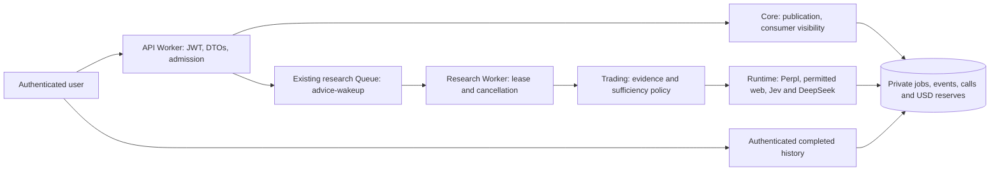

# Authenticated perpetual recommendations

## Delivery boundary

The API exposes fresh, asynchronous BTC/ETH perpetual analyses with a fixed 24-hour horizon.
This is an analysis service, not a trading service. It never signs orders, creates positions,
changes wallet/paper balances or notifies the trading executor. Mobile screens, payments/x402,
deployment and live-provider acceptance are separate deliveries. Controlled tests establish
local behavior only. Admissions are disabled by default.



The arrows above show execution flow, not code dependencies. Core owns consumer authorization
and job ports; trading depends only on core and platform primitives. Infrastructure implements
ports and owns migrations. Runtime composes provider adapters and versioned prompts. Hosts
translate HTTP/Queue messages. See [Trading architecture](trading-architecture.md) for boundaries.

## Consumer contract

Paths below are relative to `/v1/agent-advice` on the Worker and
`/api/v1/agent-advice` through the existing web transport:

| Method and path                                              | Result                                                                                         |
| ------------------------------------------------------------ | ---------------------------------------------------------------------------------------------- |
| `GET /agents/:agentId/capabilities`                          | Enabled BTC/ETH symbols, 24-hour horizon and admission availability                            |
| `POST /agents/:agentId/recommendations`                      | Strict `{ "symbol": "BTC" }` or ETH, plus `Idempotency-Key`; 202 with id, status and statusUrl |
| `GET /recommendations/:id`                                   | queued/running/completed/failed, safe timestamps, result or generic failure                    |
| `GET /agents/:agentId/recommendations?symbol=BTC&cursor=...` | Completed history, newest first, 20 items and opaque next cursor                               |

All four operations require a verified user JWT. API keys and agent HMAC cannot access them.
A JWT identifies a user; it does not establish that a request came exclusively from mobile,
prove payment or replace payment verification. The API does not charge the mobile application.
History performs no new model/provider calls. Responses use `Cache-Control: private, no-store`,
including access failures. Pending and failed requests are visible only to their requester;
completed recommendations are visible to every authenticated user while the agent is public.
No public response contains the requester, private brief/prompts/configuration, provider traces,
lease identity, internal tenant/runtime IDs or monetary costs.

Use the public marketplace agent UUID. Server-side product mappings determine runtime identity.
A new idempotency key requests fresh analysis. The same user/agent/key and symbol return the
original job; a different symbol with that key returns 409. When the feature is globally disabled,
new POST requests return 503; exact idempotent replays and reads remain available. Active work is limited to one job per user and per
runtime agent. 429 reports active work or exhausted budget; 503 reports unavailable configuration,
paused agents or unresolved provider costs. Private/unpublished agents return 404.
`statusUrl` is the canonical Worker `/v1/...` path; web clients apply the `/api` transport prefix.

## Evidence and routing

Execution revalidates publication, operator enablement, pause state, product/runtime mapping,
configuration version and permissions. Perpl must be enabled with snapshot/book/candle tools and
the requested symbol. The worker fetches 60 consecutive closed hourly candles, a ticker and a
20-level book; ticker/book age must be at most 30 seconds and skew at most five seconds, with
known timestamps and blocks. Public acquisition has a 20-second deadline. Sources enabled by
`config.sources.web` use the existing Exa adapter and site policy, requiring `searchWeb` permission.
Agent profile, authored brief and skills are provided as data; source content cannot grant tools
or change the output schema.

Prompts `perps-advice-readiness` and `perps-advice-forecast` are version 1.0.0 and separate from
portfolio studies. Jev reviews readiness, material gaps and market scope. Only a coherent,
98%-confident insufficiency with a concrete gap and matching scope skips DeepSeek, yielding
`wait` with limitations. Other valid responses request one blind DeepSeek forecast using the same
evidence and brief, excluding Jev's answer. DeepSeek returns long/short/wait, summary, reasons,
risks, limitations and existing source IDs. Results include the symbol, network, data timestamp,
generation timestamp and fixed horizon, with no size, leverage or executable order.

Invalid mandatory data, missing/invalid usage, transport errors and malformed answers fail the
job. They do not become `wait` and cause no automatic paid retries. Usage is recorded before
answer validation, so rejected output can still incur a known charge. Existing citations establish
provenance, not predictive correctness or profitability.

## Persistence, recovery and cost

Infrastructure migration `0025_agent_advice.sql` adds private RLS-enabled
`pickler.advice_jobs`, `advice_events` and `advice_calls`. Apply with `npm run db:migrate` before
running the updated API/research binaries: existing execution admission counts now include advice.
No historical reads, laboratory budgets, wallet records or paper accounts are reinterpreted.

Admission reserves the worst-case combined Jev, DeepSeek, web search and optional site-preference
fallback before any provider call. Monetary values are exact USD micro-units, rounded upward;
rates are explicit USD per million tokens. AUSD spend limits are unrelated and never converted.
Each lane is durably marked started with a request hash before transport. Rows retain model,
usage, reserved/actual cost, timestamps and private event evidence. Token limits are 30,000 input
and 2,000 DeepSeek output; request bytes are conservatively bounded by the input reservation.
Unused reservations are released only at terminal completion/failure. Actual known costs remain.

Jobs expire after ten minutes queued. Execution lasts at most three minutes, with a 60-second
lease renewed every 15 seconds. Every paid start and result write verifies ownership and current
agent admission. Global/tenant concurrency is shared with research and previews. Queue messages
are generic notifications, not instructions to replay providers. Duplicate delivery cannot reclaim
running/terminal jobs. Cron recovers pending work, expires queued jobs and marks interrupted
execution failed; calls already started never repeat. Database/notification retries only reconcile
durable state. Disabling advice prevents claim/new work but preserves recovery and history.

Unknown costs keep their original reservations and block future admissions for that agent.
An operator can reconcile a **failed** job through the trusted infrastructure
`PostgresAdviceStore.reconcileCall` method using verified provider usage/cost and an evidence SHA-256.
Model costs must match the job's original frozen rates. The method records a private audit event,
never reopens a job and is not exposed through a consumer HTTP endpoint. No automatic assumption
of zero cost or automatic refund is allowed.

## Configuration and later enablement

Both hosts default to `ADVICE_ENABLED=false`. Before any later paid enablement, review model
identifiers, verified rate sources and explicit per-request/per-agent-day USD limits, then provide
the same `ADVICE_POLICY_JSON` to API and research Worker. Required fields:

- `version: 2`, `jevModel: "jev-1.13.0"`, reviewed `deepseekModel` equal to `MODEL_ID`, and
  `deepseekBaseUrl` equal to the trusted HTTPS `MODEL_BASE_URL` (trailing slashes are ignored);
- `inputRates` and `outputRates`: decimal strings keyed `jev` and `deepseek`; Jev output rate is zero;
- `webSearchUsd`: reviewed worst-case per search, including retrieved text;
- `requestLimitUsd`, `dailyLimitUsd` (daily at least request);
- `pricingVerifiedAt` ISO timestamp and nonempty HTTPS `pricingSources`.

No example tariff here represents verified current production pricing. Test tariffs and endpoints
are controlled fixtures only. Policy validation fails closed if limits do not cover worst-case
reservations; web-enabled agents require a positive reviewed web allowance. The worker checks
that its policy exactly matches each persisted job, independent of JSON property order.

Only research receives `ADVICE_JEV_API_KEY`, plus the existing `MODEL_BASE_URL`, `MODEL_ID`,
`MODEL_API_KEY` and `EXA_API_KEY`
when web is enabled. Never bind these secrets to the API/web or commit them. Both hosts need the
existing research Queue and trusted invocation-local database transport. Shared research
`ADMISSIONS_ENABLED` and advice enablement are independent. Missing credentials or changed policy
fail queued jobs without calling providers; this delivery leaves production advice disabled.

## OpenAPI and validation

`GET /v1/openapi.json` documents mounted advice routes even when admission is off. The complete
controlled export includes the group: `npm run api:openapi -- --output /tmp/pickler-openapi.json`.
OpenAPI 3.1 uses server `/api`; generated schemas document JWT, idempotency, cursor pagination,
states and envelopes. Read [API contract](api-contract.md) when adding an endpoint.
Wallet sign-in's existing `kind` values are documented as `eoa` and `mera`.

Reproducible controlled acceptance:

```sh
npm run build:shared
node --import tsx --test packages/trading/test/advice.test.ts \
  packages/infrastructure/test/advice-store.test.ts \
  workers/api/test/advice-route.test.ts workers/research/test/advice-flow.test.ts
npm test
npm run typecheck
npm run lint
npm run format:check
npm run build:workers
npm run api:openapi -- --output /tmp/pickler-openapi.json
```

PostgreSQL suites create and migrate isolated databases using the local test connection (or
`TEST_DATABASE_URL` with CREATEDB permission). Controlled transports verify the API → Queue →
model adapters → persistence → shared history flow without real providers or trading. Remote
availability, paid-provider behavior and forecast quality remain unverified until separately
approved deployment/acceptance.

## Controlled acceptance record (2026-10-02)

Integration branch `codex/agent-advice` starts from main commit
`07fbcdc438edaeb46649e3427a5cdc17de770afc` (generated OpenAPI delivery).
The complete local suite passed 2,346 tests with zero failures and three optional skips;
those skips are not remote acceptance. Shared/service builds, workspace types, lint,
format, architecture/link checks and all Worker dry builds passed. The controlled export
contains 153 documented HTTP operations, including four advice operations.

Focused PostgreSQL tests cover concurrent idempotency, sticky unknown cost reservations,
fenced ownership, expiry/config revocation, audited reconciliation, daily USD exhaustion and
same-named runtime agents in distinct tenants. The end-to-end controlled test uses the actual
Jev/DeepSeek adapters through API and Queue, verifies blind routing and malformed-output cost
retention, and asserts zero research runs, paper accounts or trading wakeups. No migration was
applied to an existing product database, no paid provider was called and advice remains disabled.

## Configured forecast provider and policy upgrades

Forecasts use the same operator-configured OpenAI-compatible provider as ordinary research.
A DeepSeek model served by Alibaba/DashScope uses that provider’s endpoint, key and tariff;
a direct DeepSeek key/tariff cannot be substituted. `ADVICE_DEEPSEEK_API_KEY` is no longer read.
The `deepseek` call lane names the forecasting role; v2 call records identify the actual provider
origin. Forecast prompts, output checks, token limits, blind routing and no-retry behavior are unchanged.

New configurations use policy version 2. Version 1 remains readable and explicitly bound to
`https://api.deepseek.com`; it is never silently redirected to the configured provider. API and
Research must have exactly matching policy JSON. Execution also verifies the frozen base URL and
model against current `MODEL_BASE_URL` and `MODEL_ID` before data or paid model work. Any mismatch
fails the job without model transport; create a reviewed new policy for future jobs instead of
rewriting existing jobs or calls. HTTPS URLs cannot contain credentials, queries or fragments.
No schema migration is needed for this versioned JSON extension.

The following is a **non-operational template**, not verified prices or an approved budget.
Replace every `REVIEWED_*` value using the actual provider’s rates and explicit operator USD limits;
otherwise validation refuses it. Never upload it as a working policy or enable advice with it.

```json
{
  "version": 2,
  "jevModel": "jev-1.13.0",
  "deepseekModel": "REVIEWED_MODEL_ID",
  "deepseekBaseUrl": "https://dashscope-intl.aliyuncs.com/compatible-mode/v1",
  "inputRates": {
    "jev": "REVIEWED_JEV_USD_PER_MILLION",
    "deepseek": "REVIEWED_PROVIDER_USD_PER_MILLION"
  },
  "outputRates": { "jev": "0", "deepseek": "REVIEWED_PROVIDER_USD_PER_MILLION" },
  "webSearchUsd": "REVIEWED_WORST_CASE_SEARCH_USD",
  "requestLimitUsd": "REVIEWED_REQUEST_LIMIT_USD",
  "dailyLimitUsd": "REVIEWED_AGENT_DAY_LIMIT_USD",
  "pricingVerifiedAt": "REVIEWED_ISO_TIMESTAMP",
  "pricingSources": ["https://REVIEWED_PROVIDER_PRICE_SOURCE"]
}
```

Keep `ADVICE_ENABLED=false` until models, tariffs, limits and remote acceptance are reviewed.
This change does not authorize migrations, deployments, enabling advice, or paid validation.

## Provider correction acceptance (2026-10-03)

Controlled validation used Node 24.19.0 and npm 10.9.3: 20 focused advice tests passed, including
real isolated PostgreSQL API/Queue/history tests and v2 provider provenance. The full suite reported
2,354 tests: 2,351 passed, zero failed, three optional tests skipped. All 17 workspace type checks,
lint, formatting and architecture checks passed. Shared packages and API/Research dry builds passed;
OpenAPI exported 153 validated operations. No hosted migrations, paid provider calls or deployments
were performed. This establishes controlled behavior, not live-provider acceptance or reviewed tariffs.
