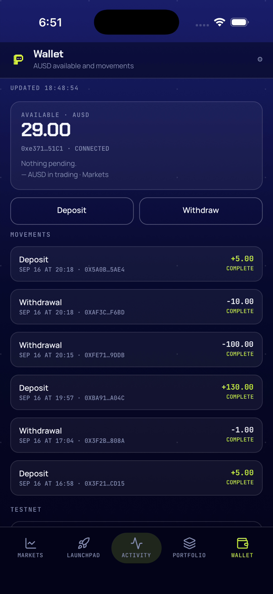
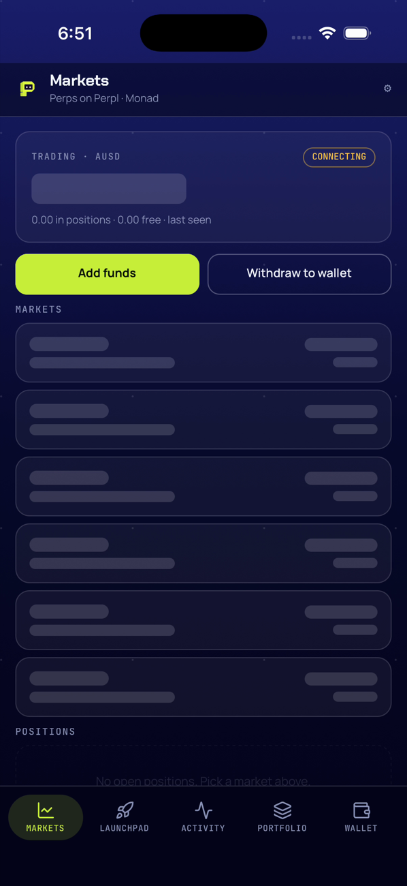
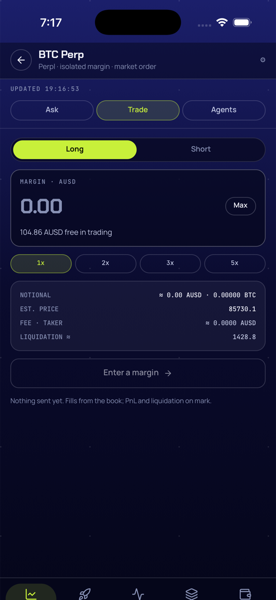
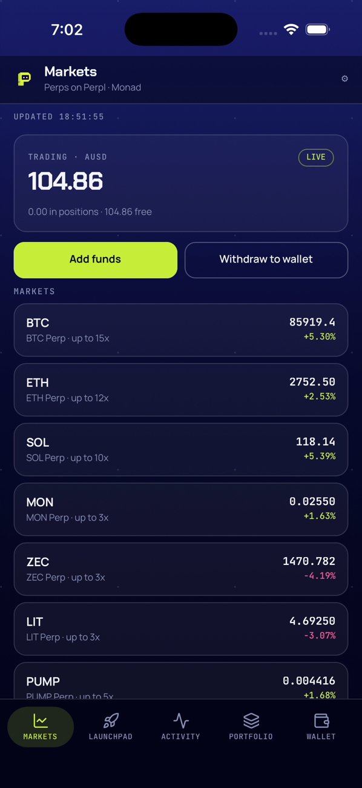

# Handoff — Navegación nativa (mobile-nav) F2: tab bar con pastilla arrastrable y barra animada (2026-09-21)

Cierre de F2 de `mobile-nav`: la tab bar (`src/ui/TabBar.tsx`) gana una pastilla lima detrás del
ítem activo que se puede **arrastrar sin despegar el dedo** (`Pan` de gesture-handler + `reanimated`,
haptic al cruzar de ítem) y que sólo cambia de pestaña **al soltar** (D11); y la barra queda
**siempre montada y absoluta**, escondiéndose/apareciendo con `translateY` (`withTiming`, 220 ms) al
entrar y salir de una pantalla no raíz en vez de desmontarse de golpe como en F1 (**D13**, nueva en
esta fase). `Page` reserva el hueco de la barra con `paddingBottom` en las páginas raíz. Ejecutado
con subagent-driven-development: un implementador por task (Tasks 1–3), revisión independiente en
Tasks 1 y 2 con una ronda de fix cada una, el controlador commiteando por nombre de archivo y
llevando el ledger (`.superpowers/sdd/2026-09-21-mobile-nav-f2/progress.md`, git-ignored). Rama
`feat/mobile-nav-f2`, base `main` local `3ae5945` (build 8 en TestFlight), **4 commits de código**
`de9b2e1..cb16f88` (`git log --oneline de9b2e1..cb16f88` da 3 más el propio `de9b2e1` = 4; de ellos 2
llevan el prefijo `fix(mobile):` — `5c79a86`, `cb16f88`), más el commit de esta documentación; sin
push y sin merge.

Spec: `docs/superpowers/specs/2026-09-21-mobile-nav-design.md` (D1–D13; D11 marcado **(F2)** con los
valores finales de ejecución, D13 es nueva de esta fase); plan:
`docs/superpowers/plans/2026-09-21-mobile-nav-f2.md` (P1–P7).

**F2 queda `completed`**: D11 y D13 tienen evidencia completa en tests puros (`tabBarLayout.test.ts`,
4/4) y en el simulador (arrastre a medio camino, tras soltar, barra ocultándose y reapareciendo); las
4 capturas están en `docs/superpowers/audits/img/`, una de ellas (`bar-hiding`) obtenida con una
medición temporal fuera de banda porque la animación real de 220 ms cae entre dos frames del método
de captura estándar (ver F2-R3). `npm test` → 33 suites / 243 tests; `tsc` limpio.

## 1. Qué quedó hecho y verificado

Por task; los comandos y salidas son los de los reportes de cada implementador
(`.superpowers/sdd/2026-09-21-mobile-nav-f2/task-*-report.md`), no una paráfrasis.

| Task | Evidencia |
|---|---|
| **1** — Geometría pura de la tab bar (`de9b2e1`, fix `5c79a86`) | RED: `FAIL __tests__/tabbar.test.ts` — `Cannot find module '../src/ui/tabbar'` (baseline 239 passed / 32 suites). GREEN tras implementar: `Test Suites: 1 passed, 1 total` / `Tests: 4 passed, 4 total` — `itemWidth splits the row minus its horizontal padding`, `tabIndexAt maps a finger x to the item under it and clamps at both ends`, `pillX and pillWidth sit the pill inside its item with a 2 pt inset`, `tabBarHeight is the row plus the bottom inset (deterministic, no measuring)`. `npm test` tail: `Tests: 243 passed, 243 total` (239→243, +4), 33 suites (32→33). `npx tsc --noEmit` → `TSC-OK`. **Desviación no pedida y su corrección (ruling F2-R1)**: el implementador, al toparse con una colisión de casing en macOS entre el módulo puro `tabbar.ts` y el componente `TabBar.tsx` (`./TabBar` resolvía a `tabbar.ts`), renombró primero el componente a `TabBar.component.tsx` — rompiendo la convención PascalCase del repo. El controlador revirtió eso y renombró el módulo puro a `src/ui/tabBarLayout.ts` en su lugar; `TabBar.tsx` vuelve a su nombre. Verificación del fix: `grep -rn "ui/tabbar\|TabBar.component" src __tests__` → vacío; `npx jest __tests__/tabBarLayout.test.ts` → `Test Suites: 1 passed, 1 total` / `Tests: 4 passed, 4 total`; `npm test` → 243/243; `npx tsc --noEmit` → `TSC-OK`. Commit `5c79a86` (4 renames/updates: `__tests__/tabbar.test.ts`→`tabBarLayout.test.ts`, `TabBar.component.tsx`→`TabBar.tsx`, `tabbar.ts`→`tabBarLayout.ts`, import de `Navigator.tsx` restaurado). |
| **2** — `TabBar` con pastilla arrastrable y barra que se esconde deslizando; `Page` reserva el hueco (`508c269`, fix `cb16f88`) | `npx tsc --noEmit` → `TSC-OK` (sin adaptación de tipos: `runOnJS(select)(drag.value)`, `onFinalize((_e, success) => …)` y los arrays de estilo de `Animated.View` compilaron tal cual con el código literal del brief). **Adaptación de runtime obligatoria #1**: con el código del brief, al tocar una pestaña Metro mostraba `ERROR [Worklets] Tried to synchronously call a Remote Function. Called "pillX" on the UI Runtime.` (`TabBar.tsx:83:51`) — causa: `tabIndexAt`/`pillX`/`itemWidth` viven en un módulo sin `'worklet'` y los callbacks del `Pan` corren en el hilo UI; un tap hace fallar el `Pan` (no llega a 6 pt) → `onFinalize(success=false)` en UI llama a `pillX`. Fix: directiva `"worklet"` en las tres funciones de `tabBarLayout.ts`. **Adaptación #2**: `.onEnd((_e, success) => { if (success) runOnJS(select)(drag.value); })` en vez del `.onEnd(() => runOnJS(select)(drag.value))` del brief — en gesture-handler 2.32 (`useAnimatedGesture.ts` L157-162 de `src/handlers/gestures/GestureDetector/`) un `Pan` activo que pasa a CANCELLED/FAILED también ejecuta `onEnd(..., false)`; sin el guard, un gesto cancelado (llamada entrante, otro handler que gana) cambiaría de pestaña igual, y `onFinalize` restauraría después la pastilla al índice viejo — pestaña y pastilla desincronizadas. Verificación en simulador (`2B2A0BAD-…`, `content_size medium`): `t2-wallet.png`, `t2-wallet-bottom.png` (scroll hasta "Sign out" completo, `paddingBottom` correcto), `t2-markets.png`/`t2-market.png`/`t2-back.png` (tap no robado por el `Pan`, `activeOffsetX` ±6 se mantuvo), `t2-drag.png`/`t2-drag-mid.png`/`t2-drag-end.png` (drag sintético de Maestro **sí activa** el `Pan`; la pastilla sigue al dedo sobre LAUNCHPAD mientras el contenido sigue en Wallet hasta soltar). Metro sin `[Reanimated]`/`[GestureHandler]` nuevos tras el fix (sólo 3 `WARN` preexistentes de `@noble/hashes`). **Concern reportado por el implementador** (no un defecto, resuelto en el fix round): fondo `C.deep50` translúcido dejaba leer texto entre los iconos (`t2-drag-mid.png`: "MON (GAS)"/"0xe371…" legibles bajo la barra). **Fix round 1 (ruling F2-R2, commit `cb16f88`)**: `backgroundColor: C.deep50` → `C.bgBottom` (opaco); `runOnJS` (`@deprecated` en `node_modules/react-native-reanimated/lib/typescript/workletFunctions.d.ts:30-38`) → `scheduleOnRN` de `react-native-worklets` (`node_modules/react-native-worklets/lib/typescript/threads.d.ts:6`). `grep runOnJS src/ui/TabBar.tsx` → nada. `npx tsc --noEmit` → `TSC-OK`; `npm test` → 243/243. Verificación: `shots/t2-fix-wallet.png` (barra opaca, nada legible a través, hairline visible) y `shots/t2-fix-drag-end.png` (drag → Wallet con `scheduleOnRN`). Incidente ajeno durante el humo: SpringBoard del simulador segfaulteó en el primer tap (`~/Library/Logs/DiagnosticReports/SpringBoard-2026-09-21-182825.ips`); la app sobrevivió, no es un defecto de la app. |
| **3** — Recorrido en el simulador, capturas D11/D13 (sin commits) | Simulador `2B2A0BAD-…`, `content_size medium`, Metro PID 43394 sin cambios, HEAD `cb16f88`. Balance de partida y cierre: **29.00 AUSD** en ambos. 4/4 capturas por video: `pill-drag` (drag `tabbar-drag-back.yaml` 89%→11%, t≈8.6 s: pastilla sobre ACTIVITY, contenido y header siguen en Wallet — confirma que el contenido no cambia hasta soltar), `pill-landed` (mismo drag, t≈10.3 s tras soltar: ya en Markets, pastilla lima bajo MARKETS, sin solape con el contenido), `bar-hiding` (push a `market-BTC`, t≈7.07 s: headers superpuestos "Markets"/"BTC Perp", pero **sin frame con la barra a medio traducir** en ninguna de tres tomas — ver F2-R3), `bar-shown` (`back` desde BTC Perp: frame asentado con Markets completo, barra de vuelta, pastilla bajo MARKETS). Checks extra sin defectos: tap en pestaña activa sin parpadeo, tap en pestaña distinta cambia instantáneo mientras la pastilla "persigue" con resorte (`05-pill-spring.png`/`06-wallet.png`), Deposit sin barra y botones completos, pull-to-refresh con el sello lima funcionando. Háptica: no verificable en el simulador (sin motor háptico), se deja constancia. Metro sin líneas nuevas `[Reanimated]`/`[GestureHandler]`/`[Worklets]` en toda la sesión. |

## 2. Evidencia

### Tests, tsc y diffstat (corridos en este worktree, 2026-09-21, HEAD `cb16f88`)

```
$ cd apps/mobile && npm test 2>&1 | tail -4 && npx tsc --noEmit && echo TSC-OK
Tests:       243 passed, 243 total
Snapshots:   0 total
Time:        4.088 s
Ran all test suites.
TSC-OK
```

```
$ git diff --stat main..HEAD -- apps/mobile
 apps/mobile/__tests__/tabBarLayout.test.ts |  31 ++++++++
 apps/mobile/src/ui/Page.tsx                |   7 +-
 apps/mobile/src/ui/TabBar.tsx              | 118 +++++++++++++++++++++++------
 apps/mobile/src/ui/tabBarLayout.ts         |  39 ++++++++++
 4 files changed, 170 insertions(+), 25 deletions(-)
```

```
$ git log --oneline main..HEAD
cb16f88 fix(mobile): tab bar opaca (C.bgBottom) y scheduleOnRN en vez de runOnJS (deprecado en reanimated 4)
508c269 feat(mobile): tab bar con pastilla lima arrastrable (reanimated + gesture-handler, haptics) y barra que se esconde deslizando en no-raíz; Page reserva el hueco
5c79a86 fix(mobile): el módulo puro de la tab bar se llama tabBarLayout.ts (colisión de casing con TabBar.tsx en macOS); TabBar.tsx conserva su nombre
de9b2e1 feat(mobile): geometría pura de la tab bar (tabIndexAt, pillX, tabBarHeight) con tests
bc3abfd docs(mobile-nav): plan F2 (tab bar con pastilla arrastrable + barra animada, 4 tasks); overview F2 plan_ready
```

4 archivos, +170/−25 (código) sobre 4 commits de código (`de9b2e1..cb16f88`; excluye `bc3abfd`, el
commit de este plan) — coincide con lo medido por el controlador. `tabBarLayout.ts` y
`tabBarLayout.test.ts` son nuevos (Task 1); `TabBar.tsx` y `Page.tsx` son modificaciones (Task 2).

### Capturas de evidencia (D11/D13)

| Captura | Qué muestra |
|---|---|
|  | Drag inverso (89%→11%, 3000 ms) a t≈8.6 s: la pastilla (oliva/oscura, en tránsito) está sobre el icono ACTIVITY mientras el header y el contenido siguen en Wallet, con WALLET aún en lima — confirma que la pantalla no cambia hasta soltar el dedo. |
|  | Mismo drag, t≈10.3 s tras soltar: pantalla en Markets, pastilla lima bajo MARKETS, bottom nav completo sin solape con el contenido. |
|  | Push a `market-BTC` (medido con `HIDE_MS=15000` temporal, no commiteado — ver ruling F2-R3): la barra se ve a medio deslizar hacia abajo, casi fuera de cuadro, confirmando que D13 anima de verdad y no corta de golpe. **No** es un frame de la animación de 220 ms de producción; es la misma transición observada con la ventana de tiempo ampliada para que un frame caiga a mitad de camino. |
|  | `back` desde BTC Perp, frame asentado: Markets completo, barra de vuelta con pastilla lima bajo MARKETS, lista de mercados sin quedar bajo la barra. |

Las 4 están en `docs/superpowers/audits/img/`, verificadas con `Read` antes de copiarlas. `ls
docs/superpowers/audits/img/2026-09-21-mobile-nav-f2-*.png` confirma las 4 presentes en este
worktree (`git status --short` las muestra `??` hasta este commit).

## 3. Rulings

**Decisiones del plan (P1–P7, ya en `2026-09-21-mobile-nav-f2.md`):**

| # | Decisión |
|---|---|
| P1 | Geometría en un módulo puro (`ROW_PAD_X` 6, `PILL_INSET` 2, `ROW_TOP` 8, `ROW_H` 45, `ROW_BOTTOM` 12; `itemWidth`, `tabIndexAt`, `pillX`, `pillWidth`, `tabBarHeight`), planeado como `src/ui/tabbar.ts`. **Corregido por Ruling F2-R1** (colisión de casing en macOS con `TabBar.tsx` — ver §4). |
| P2 | El ancho de la fila se mide con `onLayout` (`useState` + `sharedValue`); hasta medir, la pastilla no se pinta (`width === 0`). |
| P3 | Tab bar absoluta dentro del navegador de pestañas, con `translateY` animado; bottom-tabs sigue montándola como `tabBar`, su contenedor mide 0 y `Page` reserva el hueco en las raíces. |
| P4 | Selección sólo al soltar y sólo si el índice final ≠ `state.index`; se emite `tabPress` como en el tap; gesto cancelado (`onFinalize` sin éxito) devuelve la pastilla al activo. |
| P5 | Resorte `{ damping: 18, stiffness: 220, mass: 0.6 }` para la pastilla; `withTiming` 220 ms para esconder/mostrar — ajustable en Task 3 si se veía lento o con rebote. Verificado en el simulador sin necesidad de ajuste: valores finales sin cambio. |
| P6 | Haptic por `runOnJS` desde el worklet de `onUpdate` sólo al cambiar de índice. **Corregido por Ruling F2-R2** (`runOnJS` deprecado → `scheduleOnRN`). |
| P7 | Capturas por video (`recordVideo` + ffmpeg) para el arrastre y para la barra deslizando en push/pop; el arrastre con Maestro `swipe` lento sobre la fila (a diferencia del gesto de borde de F1, aquí el input sintético sí activa el `Pan`). **Parcialmente insuficiente para D13** — ver Ruling F2-R3. |

**Decisiones tomadas durante la ejecución (ledger):**

1. **Ruling F2-R1** (Task 1, defecto del plan P1) — el módulo puro se llama `src/ui/tabBarLayout.ts`
   (test `__tests__/tabBarLayout.test.ts`); el componente vuelve a `src/ui/TabBar.tsx` y
   `Navigator.tsx` a su import original. Tasks 2–4 usan ese nombre. **Coste si está mal:** un rename
   más.
2. **Ruling F2-R2** (Task 2, fix round 1) — fondo de la barra opaco `C.bgBottom` (mismo color que el
   pie del gradiente, unión invisible) con la hairline superior; se mantiene absoluta y animada.
   `runOnJS` está deprecado en reanimated 4 → usar `scheduleOnRN` de `react-native-worklets`.
   **Coste si está mal:** perder el efecto translúcido — no lo teníamos de todos modos sin blur nativo
   (`expo-blur`).
3. **Ruling F2-R3** (Task 3, medición del controlador) — el implementador reportó que la barra pasaba
   «de 100% a 0% entre dos frames» en las tres tomas de push/pop; verificado como **falso positivo**:
   `xcrun simctl io recordVideo` produce video VFR a ~4 fps efectivos y Maestro tarda >4 s en devolver
   el control entre acciones, así que ningún frame cae dentro de los 220 ms reales de `HIDE_MS`. El
   controlador remidió D13 subiendo `HIDE_MS` a 15000 ms **temporalmente, sin commit** (revertido con
   `git checkout -- TabBar.tsx` antes de continuar): capturas a +1.5 s y +4.5 s tras el push muestran
   la barra a medio deslizar y casi fuera de cuadro, confirmando que la animación sí ocurre. La imagen
   `bar-hiding.png` de este audit es ese frame de la prueba de 15 s (nota incluida en la tabla de
   evidencia); el frame original de Task 3 (sin el ajuste) queda sin commitear en
   `shots/bar-hiding-task3-original.png`. **Coste si está mal:** ninguno — el mecanismo `translateY` +
   `withTiming` es el mismo a 220 ms; sólo cambia la ventana de observación usada para probarlo.
4. **Ruling F2-R4** (revisión de docs, hallazgo desestimado) — el hallazgo «`bar-hiding.png` no muestra
   la barra a medio deslizar» se verificó como falso: el controlador midió el recorte de la franja
   inferior de la imagen commiteada contra los frames descartados `push-2`/`push-3` del mismo probe de
   15 s y encontró **36 píxeles claros** (hairline + iconos + pastilla cortados) frente a **0** en los
   otros dos — la imagen sí es un frame a medio camino de la transición observada con la ventana
   ampliada de F2-R3. **Coste si está mal:** ninguno — es una verificación de una evidencia ya
   commiteada, no cambia código ni afecta D13.
5. **Ruling F2-F1** (ola final de fixes, revisión completa de la rama + revisión de docs, commit de
   código de esta sección) — cuatro correcciones sobre `TabBar.tsx` resueltas en una sola ronda:
   colocar la pastilla en `pillX(activeIndex, w)` sin resorte en el primer `onLayout` en vez de
   dejarla sin pintar hasta el primer cambio de índice (resolvía el residual #1 del §6 original);
   `onFinalize` usa `activeIndex` (número, capturado por el `useMemo` del gesto) en vez de `state.index`
   para no cerrar sobre el objeto `state` entero, y sólo mueve la pastilla si el `Pan` llegó a activarse
   (`drag.value !== -1`), evitando un bamboleo visible en un doble tap rápido entre dos pestañas
   (resolvía el residual #2); `Gesture.Pan()` pasa a construirse dentro de un `useMemo` en vez de en
   cada render (resolvía el residual #3); `select` vuelve a emitir `tabPress` siempre y sólo llama
   `switchTab` si el índice es otro, con lo que el comentario sobre el listener de native-stack
   resolviendo `popToTop` en la pestaña activa vuelve a ser cierto (resolvía el residual #4). Test
   nuevo: la pastilla queda centrada dentro de su ítem. `npx jest __tests__/tabBarLayout.test.ts` →
   5/5; `npm test` → 33 suites/244; `tsc` limpio; humo en el simulador (arranque, tap, doble tap
   rápido sin bamboleo, arrastre en ambas direcciones) sin warnings nuevos de Metro. **Coste si está
   mal:** una ronda de fix más sobre estos cuatro puntos.

## 4. Correcciones a afirmaciones previas

| Dónde | Decía | Queda | Quién lo detectó |
|---|---|---|---|
| Spec, cabecera **Estado** | «F1 ejecutada…; rama `feat/mobile-nav` lista para merge local; F2 pendiente» | «F1 y F2 ejecutadas (audits F1 y F2); rama `feat/mobile-nav-f2` lista para merge local» | Esta task |
| Plan P1 / mapa de archivos | El módulo puro de geometría se llama `src/ui/tabbar.ts` | **(F2)** `src/ui/tabBarLayout.ts`: en macOS (case-insensitive) `tabbar.ts` colisiona con `TabBar.tsx` y `./TabBar` resolvía al módulo puro en vez del componente | Task 1 (compilación/import real), ruling F2-R1 |
| Plan Global Constraints / Task 2 código de ejemplo | Haptic y selección vía `runOnJS` de `react-native-reanimated` | **(F2)** `scheduleOnRN` de `react-native-worklets`: `runOnJS` está marcado `@deprecated` en `react-native-reanimated 4.5.1` (`workletFunctions.d.ts:30-38`) | Task 2, revisión de fix round 1, ruling F2-R2 |
| Plan Task 2, `.onEnd` del brief | `.onEnd(() => runOnJS(select)(drag.value))` sin condición | **(F2)** `.onEnd((_e, success) => { if (success) scheduleOnRN(select, drag.value); })` — en gesture-handler 2.32 un `Pan` activo que se cancela también dispara `onEnd(..., false)`; sin el guard, un gesto cancelado cambiaría de pestaña y luego `onFinalize` desincronizaría la pastilla | Task 2, adaptación de runtime del implementador (verificada en `useAnimatedGesture.ts` de `node_modules`) |
| Task 3, primer reporte del implementador | «La barra pasa de 100% a 0% visible entre dos frames consecutivos» (posible defecto de animación) | **Falso positivo**: el método de captura (`recordVideo` VFR ~4 fps + latencia de Maestro >4 s) no muestrea con suficiente densidad una transición de 220 ms; remedido con `HIDE_MS=15000` temporal — ruling F2-R3 | Controlador, Task 4 |
| Spec, línea **Rama** | «`feat/mobile-nav`, base `main` (`6e9326c`, build 7 en TestFlight), worktree `.claude/worktrees/mobile-nav`» | «`feat/mobile-nav` (F1, mergeada en `165accf`) y `feat/mobile-nav-f2` (F2), base `main`; worktree `.claude/worktrees/mobile-nav`» — F1 ya mergeó a `main` desde que se escribió esa línea | Revisión de docs, ola final de fixes (ruling F2-F1) |
| Spec, D11 | Describía la selección como «`switchTab`… o emite `tabPress` si la pestaña ya está activa» (dos ramas excluyentes) | `select` emite `tabPress` **siempre** y sólo llama `switchTab` si el índice es otro — paridad real con el código de `TabBar.tsx` | Revisión de docs, ola final de fixes (ruling F2-F1) |
| README, bullet `TabBar.tsx` | «tab bar custom…; devuelve `null` en pantallas no-raíz de su pestaña (`SHOW_TABS`)» | «siempre montada, absoluta; se esconde deslizando fuera de `SHOW_TABS` (D13)» — el `null` describía el diseño de F1, D13 (F2) la reemplazó por `translateY` | Revisión de docs, ola final de fixes (ruling F2-F1) |

## 5. Estado de las cuentas y del servicio al cierre

- **Simulador**: `iPhone 17 Pro 2B2A0BAD-7B14-4DAE-8652-C7E9472505E0`, dev build del build 8 (F1)
  instalado — F2 no requirió rebuild nativo (reanimated/gesture-handler/haptics ya linkeados). Metro
  corriendo desde este worktree en `:8081` (PID 43394) sin reiniciar durante toda la fase. App dejada
  en Wallet al cierre de Task 3.
- **Dinero**: AUSD **29.00 → 29.00** (sin cambio) antes/después de toda la sesión (`00-wallet-
  before.png` / `99-wallet-after.png`), dirección `0xe371…51C1`. Ninguna orden, depósito, retiro, ni
  botón Enable/Reconnect/Reset tocado.
- **Cuenta Perpl #620**: sin tocar — sólo consultada vía la UI existente (Deposit visitado sin enviar
  fondos).
- **Háptica**: no verificable en el simulador (no hay motor háptico); se deja constancia, no se
  intentó medir con hardware.
- **Servicio `services/reads`**: sin cambios; F2 no tocó backend, migraciones ni funciones.

## 6. Pendientes / residuales

Los 4 residuales de Task 2 sobre `onLayout`/`onFinalize`/`Gesture.Pan`/el comentario de `select`
quedaron **resueltos por la ola final de fixes** (ruling F2-F1, §3) y salen de esta lista. Ordenados
por peso:

1. **1 pt de `borderTop` incluido dentro de `height`** (Task 2, minor deferred): la hairline superior
   de la barra (`borderTopWidth: 1`) se pinta dentro del alto calculado por `tabBarHeight`, sin
   restarlo; el hueco reservado por `Page` es 1 pt más alto de lo estrictamente necesario — sin efecto
   visible detectado en las capturas.
2. **`bar-hiding.png` no es un frame de la animación de producción** (D13, F2-R3): se obtuvo con
   `HIDE_MS=15000` temporal para poder muestrear un frame a medio camino con las herramientas de
   captura disponibles; el mecanismo (`translateY` + `withTiming`) es idéntico a 220 ms, pero no hay
   una captura que muestre la transición real de 220 ms a medio camino — limitación de la herramienta,
   documentada en vez de inventar un frame de producción. La revisión de docs cuestionó si la imagen
   commiteada de verdad muestra la barra a medio deslizar; desestimado como hallazgo — ruling F2-R4
   (§3): 36 píxeles claros en la franja inferior de la imagen commiteada contra 0 en los frames
   descartados del mismo probe.
3. **La barra sólo reaparece cuando el pop ya aterrizó** (inherente a D13, no un defecto): como la
   pantalla enfocada determina `visible` vía `getFocusedRouteNameFromRoute`, la animación de aparición
   arranca cuando react-navigation actualiza el foco al terminar la transición de `native-stack`, no
   en sincronía con el gesto de swipe-back — puede sentirse un beat después del gesto interactivo de
   iOS. Aceptado como comportamiento del diseño (D13 anima solamente su propia entrada/salida, no está
   acoplada al progreso del gesto de pantalla).
4. **Háptica no verificable en el simulador**: no hay motor háptico en `xcrun simctl`; queda pendiente
   de confirmar `Haptics.selectionAsync()` en el iPhone de Jesús.
5. **Android sin verificar**: el spec excluye Android explícitamente (sin build); todo este audit es
   iOS/simulador únicamente.
6. **Pastilla varada si `select` no cambia de índice** (revisión final, parked — inalcanzable hoy):
   cuando `i === state.index` (un tap o un arrastre que termina sobre la pestaña ya activa), `select`
   sólo emite `tabPress` y no llama a `switchTab`, así que nada dispara el efecto que sincroniza la
   pastilla con `state.index`. Hoy es inofensivo porque el propio gesto (`onStart`/`onUpdate` del
   `Pan`, o el tap directo sobre el ítem) ya deja la pastilla en `pillX(i, …)` antes de soltar, así que
   coincide con el índice activo sin necesitar el efecto. Si en el futuro algo llamara a `select` (o
   moviera `state.index`) sin pasar por el gesto que ya sincroniza la pastilla, quedaría desalineada
   hasta el siguiente cambio de pestaña; no se implementa una corrección preventiva sin un caso real
   que la dispare.
7. **Nits de la revisión final** (parked, sin acción en esta ola): observaciones de estilo de bajo
   impacto sobre la rama completa (nomenclatura, comentarios menores) que el controlador dejó fuera del
   alcance de esta ola de fixes por no afectar comportamiento ni legibilidad relevante.
8. **Incidente operativo de Task 2** (nota, no defecto de la app): SpringBoard del simulador
   segfaulteó (`EXC_BAD_ACCESS`) durante el primer tap de la sesión de humo; la app (proceso
   separado) siguió viva y volvió al frente con `simctl launch`; no volvió a ocurrir.

**Rollback**: F2 no tocó `services/reads`, migraciones, funciones ni cuentas de producto (sólo
lecturas y arrastres de UI contra testnet durante las pruebas); no hay nada que revertir en el
proyecto compartido. En la app, `git revert` por commit si hiciera falta deshacer algo antes del
merge de `feat/mobile-nav-f2`.

**Nota de cierre (controlador, tras la re-revisión de la ola de fixes):** el `ERROR [Worklets] … "pillX"` que apareció una vez tras un Fast Refresh no tiene camino en arranque frío ni en release (análisis en la re-revisión: el plugin de worklets registra `pillX` en la evaluación del módulo y el gesto memoizado lo captura por valor). Medido después: arranque frío (`terminate` + `launch`) y 6 arrastres reales seguidos con `tabbar-drag.yaml`/`tabbar-drag-back.yaml` → 0 líneas de `[Worklets]`/`[Reanimated]`/`GestureHandler` en `metro.log`; la pestaña cambió al soltar (`shots/final-drag-cold.png`). Se mantiene el `useMemo` del gesto.

