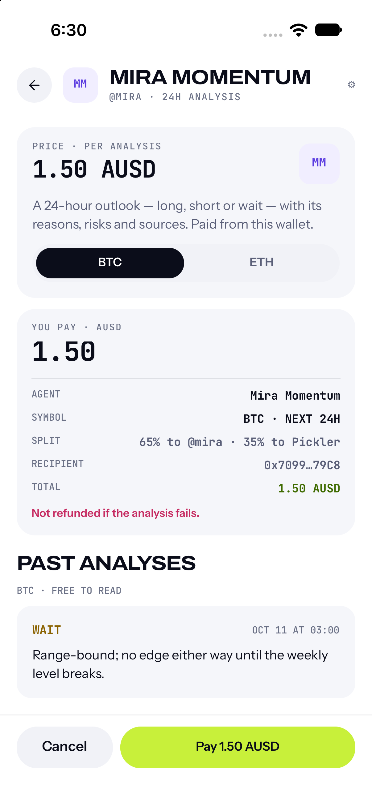
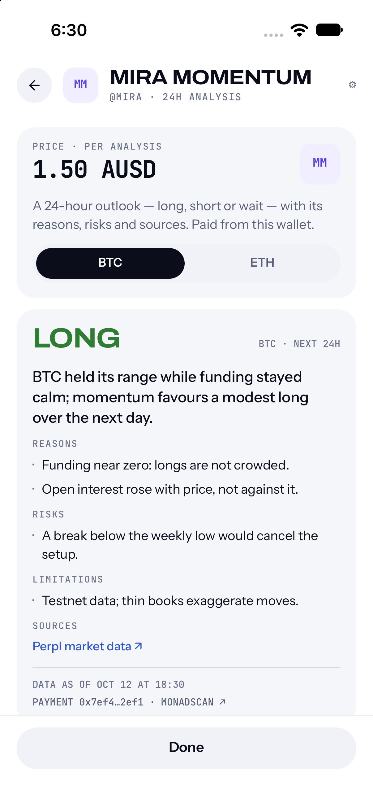
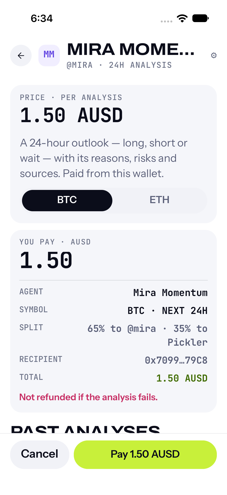

# Studio agents in the app: F1 rulings (2026-10-12)

Closes the code of the Studio agents project (product phase 3): the Agents tab lists the Studio agents,
a person picks BTC or ETH, pays one 24-hour analysis in AUSD with x402, waits and reads it. Branch
`codex/mobile-studio-agents`, stacked on `codex/advice-fee-split` (PR #161), worktree
`.claude/worktrees/mobile-studio-agents`, plan commit `d2fec74e`, code commits `d2fec74e..bb635690`,
the documentation commit `b8b67532` and the final review's fix wave (`61aba169`, `8a4328bd` and the
documentation commit that carries this text). No push, no merge, no deploy, no TestFlight build.

Plan: `docs/mobile/superpowers/plans/2026-10-12-studio-agents-app.md`. Specs:
`docs/specs/agent-advice-x402-v1.md` (§3.2, §6, §7) and `docs/specs/agent-advice-fee-split-v1.md`
(S2/S5/S6, §4, §5, §8). Executed with subagent-driven-development: one implementer per task, a review
per task with fix rounds, and the coordinator keeping the ledger
(`.superpowers/sdd/2026-10-12-studio-agents-app/progress.md`, git-ignored). Task 6 (final review, PR,
build 13, acceptance) is not done.

**Language.** This audit and its overview are in English, like the plan they document and the root
rule for new files; older audits in this folder are Spanish.

## 1. Rulings

Decisions taken without the owner. "Cost if wrong" is what each one costs.

| # | Ruling | Cost if wrong |
|---|---|---|
| A1 | The app generates a new Idempotency-Key for each Ask from idle. It reuses the key only between the 402 and the paid retry of the same Ask, and for "check again" polling of an accepted job. After `settlement_failed` (row pending on the server) the app never signs again for that Ask: it shows "payment being checked" and offers to check later. | A reused key over a pending row gets `invalid_payment` from the phase 1 server anyway. A person whose first attempt was rejected before signing gets a fresh key, which is harmless. |
| A2 | The splitter address is build config, like `PICKLER_API_URL`: `ADVICE_SPLITTER_ADDRESS` becomes `extra.adviceSplitter` and `src/config/advice.ts`, `null` when unset or invalid. Studio agents are off unless both variables are set. `checkTerms` returns `untrusted` unless `payTo` equals it (case-insensitive). | One more build variable to set for build 13. A wrong value hides the section or refuses every 402. |
| A3 | The paid POST (with `X-PAYMENT`) has its own 60 s deadline (`PAID_TIMEOUT_MS`); all other advice calls keep 15 s. The server waits up to 30 s for the receipt after simulating. | A slow failure is reported later. With 15 s a normal settlement would read as offline. |
| A4 | Payment consent is the explicit "Pay {price} AUSD" tap on the confirmation, which shows the total, the 65/35 split, the recipient and the not-refunded line. The unlock follows the withdraw rule (Face ID only when the wallet is locked), but with a locked wallet it happens **when the person taps Ask**, not at the confirmation: the quote is an authenticated POST and needs the account's JWT, which needs the wallet. So the confirmation is reached with the wallet already open, and **every payment is one tap with no biometric at that step**. Face ID shows at the confirmation only if the wallet was locked again after the quote. Restated by Ruling A7. | Spec §3.2 step 4 placed Face ID at the sheet ("Face ID opens the key, as withdrawals do"); withdraw unlocks at its confirmation because nothing before it needs the wallet. Moving the unlock to the confirmation is an **open owner decision** (A7). |
| A6 | Task 5 (docs only) is reviewed inside the final whole-branch review instead of a separate task review. | None: the final reviewer checked the docs against the code and found I1 there. |
| A7 | The final review's I1 is closed in the docs (option a): A4 says where Face ID really happens. Option b, deferring the unlock to the confirmation by quoting with the in-memory token while it is fresh, changes `authedFetch`'s rule that a call needs an open wallet, so it is left to the owner. | If the owner wants a biometric at the payment step: a later change to request the quote with the cached token and unlock at "Pay". |
| A5 | `abandon()` is also allowed from `timeout`, not only from `settlement_pending`. The job exists, so leaving cannot double-charge the same Ask. | None found: a later Ask is a deliberate new purchase. |

## 2. Corrections and findings per task

Each was found by the per-task review and closed in a fix round unless stated.

| Task | Finding | Detected by | Correction |
|---|---|---|---|
| 1 | **Critical.** `payTo` was not pinned: a hostile or buggy 402 could name any address and the app would sign the full price to it (`receiveWithAuthorization` lets `to` redeem). The plan had omitted `payTo`. | Task 1 review | Ruling A2; `checkTerms` takes the splitter (`33ecef07`). |
| 2 | **Important.** `run()` mapped `WalletLockedError` and sign-in failures to `network`, so a locked wallet looked like being offline. | Task 2 review | `WalletLockedError` is rethrown; a failed sign-in becomes `signin_<code>`; `authedFetch` requires a leading "/" and accepts `Headers` (`78b98dfc`). |
| 3 | **Important.** Ruling A3 was not implemented: the paid POST still had 15 s. | Task 3 review | `PAID_TIMEOUT_MS` (`394972ad`). |
| 3 | **Important.** `ask()` and `reset()` could replace a flow after a payment went out: a second signature while the first might settle (double charge), or a paid job id dropped. Failures after paying (bad response, sign-in error) were dead ends. | Task 3 review | Guards while a payment is in flight or unresolved; every post-payment failure goes to `settlement_pending` or `offline{paid:true}`, never to "nothing charged" (`394972ad`). |
| 3 | `authedFetch` read the wallet from a ref that updates only on render, so "unlock then retry" threw `WalletLockedError` again. | Task 3 implementer | Optional third parameter `opened?: Wallet` (`9e7e6b17`). |
| 3 | A caller-supplied `Authorization` travelled beside the bearer. | Task 2 review, carried | Dropped before ours is set (`3fb9b31c`). |
| 4 | **Important.** The username gate could open over a paid Ask: `appQuiet` did not count the advice flow, and unlocking the wallet is what triggers the check. Its only exits are claiming a handle or signing out, which drops the paid job from view. | Task 4 review | `keepsGateOff(state)` read by `App.tsx` (`bb635690`). |
| 4 | The flow had to survive navigation remounts. | Task 3 review, carried | `useStudio` at app level above the stacks, exposed as `ctx.studio`; a test mounts the real screen, pays, unmounts, remounts and asserts 1 signature (`80ed6657`). |
| 4 | Minors closed in the fix round: the "elsewhere" copy, a delisted agent hiding its own paid flow, a screen-level test of the elsewhere warning. | Task 4 review | `bb635690`. |
| All | **Important (I1).** The docs said Face ID gates the payment; in the code a locked wallet is opened at Ask, for the quote's sign-in, and Pay signs with no further prompt. | Final review | Docs restated (A4, A7, residual 4, the overview, `apps/mobile/AGENTS.md`). The confirmation's Face ID hint stays: it renders, truthfully, only when the wallet was locked again after the quote. |
| All | **M1.** `offline` with a payment out had no way out but "Try again", and after Lock in Wallet an ended Mera session on a new sign-in read as `network`, so it could loop until a restart. | Final review | `abandon()` also leaves a paid `offline` (same warning line, never signs); `run()` maps `SESSION_ENDED` to `WalletLockedError`, so retries and replays reopen the wallet; a poll that hits it drops the stale wallet and never prompts (`8a4328bd`). |
| All | **M2.** A 503 before the quote read "Couldn't ask this agent"; the payment-being-checked text did not cover a payment that landed but is not queued yet. | Final review | "This agent can't answer right now"; the text now says it may still be landing or landed and not queued yet (`8a4328bd`). |
| All | **M3.** `apps/mobile/README.md` had stale test counts; this audit cited a screenshot name that read like a commit. | Final review | Counts updated; the reference names the commit and the file. |
| All | **M4.** A mixed-case `payee` with a bad checksum passed `checkTerms` and failed only at Pay. | Final review | Strict address validation of `payee` and `payTo`: such a 402 is `untrusted` (`61aba169`). |

## 3. Evidence

| Check | Result |
|---|---|
| Mobile Jest | **52 suites / 359 tests** at the base, **60 suites / 529 tests** at the end of Task 4 (`bb635690`), **60 suites / 539 tests** after the final fix wave (`8a4328bd`), all passing. Reports: 446, 470, 498, 513, 526 after each task. |
| Typecheck | `npm run typecheck --workspace=@pickler/mobile` clean after each task. |
| `app:tree` | Unchanged: 795 packages, 1924 edges, as recorded. No dependency added. |
| Defect checks | Each new test was seen failing against its defect (Task 1: 12; Task 2: 10; Task 3: 23 hook mutations and 2 identity checks, including re-paying after `settlement_failed`, a reused key, a trusted `payTo`, a truncated 64-byte signature). Final fix wave: 8 tests failed against the unfixed code (M4's `payee` and `payTo` lines each on its own, 4 hook tests and 3 screen tests of M1/M2), and 2 guard tests failed against a mutation (abandon from an unpaid `offline`; Face ID cancelled on the reopen sent back to idle). |
| Hermes | `btoa` and `atob` work on device: the mock recovered the signer from the decoded `X-PAYMENT`; the app decoded `X-PAYMENT-RESPONSE`. `crypto.randomUUID` is absent, so the Idempotency-Key is the 32-hex `getRandomValues` fallback; the server accepts 1 to 200 characters (checked). |
| Simulator | Full path (list, advice, confirmation, wait, result, refused, settlement pending, leave, elsewhere) at the default text size and at XXXL, against a local mock server (`.superpowers/sdd/2026-10-12-studio-agents-app/mock/server.mjs`). 21 screenshots in `.superpowers/sdd/2026-10-12-studio-agents-app/screens/` (git-ignored); three are copied here. The XXXL pass found a "Cance/l" wrap in the confirmation, fixed in `80ed6657` (a minimum width on Cancel); the screenshot is `x03c-confirmation-xxxl-fixed.png`. |

The installed Pickler.app on simulator 700707EF still carries `PICKLER_API_URL=http://localhost:8899/v1`
and a test splitter; the next session should `run:ios` with its own environment.

## 4. Residuals, heaviest first

1. **The payee is trusted from the 402.** The pinned splitter protects `payTo`, but the 65% share goes to the `payee` the 402 names, and the marketplace DTO has no agent wallet to cross-check. The confirmation shows the recipient. Closing it needs the agent wallet in the DTO.
2. **A flow is not recovered if the app is killed after paying.** The job is requester-only while pending; the person can read the completed analysis in the free history once it is done.
3. **History shows only the first page** (`nextCursor` is ignored).
4. **Not seen on a device:** the Face ID prompt that a locked wallet shows when the person taps Ask (the simulator wallet was already unlocked; there is no prompt at Pay unless the wallet was locked again after the quote, see A4), and the username gate over a paid Ask (the mock always has a username). The predicate and `appQuiet` are tested; the `App.tsx` wiring is one line. Both are for build 13 on a device.
5. **Where Face ID gates the payment is an open owner decision** (A7): spec §3.2 step 4 places it at the sheet; the app unlocks at Ask and takes the "Pay" tap as consent.
6. **States not rendered:** untrusted, price_changed, failed, busy and offline; the hook tests cover the logic and code review the copy. Timeout and checking-again were captured in the fix round. The final fix wave's copy (the 503 title, the payment-being-checked text, Leave on a paid offline) is pinned by screen tests but was not re-captured on the simulator, so `07-settlement-pending.png` shows the older text.
7. **Minors deferred:** device clock skew reads as an expired authorization; `parseAusdAmount` does not enforce the 0.10 to 100 range; parallel 401s may sign in twice (bounded); an unlock failure (not a cancel) on the paid POST reads as `settlement_pending` (over-cautious, never "nothing charged"); sign-out during a paid flow drops it.
8. **Acceptance is pending operations**, not code: the splitter deployed, the API with `ADVICE_X402_ENABLED=true`, the relayer, the splitter variables, the advice keys and a priced agent (x402 spec §7, fee-split spec §8).

## 5. Rollback

The phase wrote nothing to a shared environment: no deploy, no TestFlight upload, no contract or account
change. Rolling back is not merging the branch. When build 13 exists, withdrawing the feature is shipping
a build without `ADVICE_SPLITTER_ADDRESS` (the section disappears; nothing else reads it).
