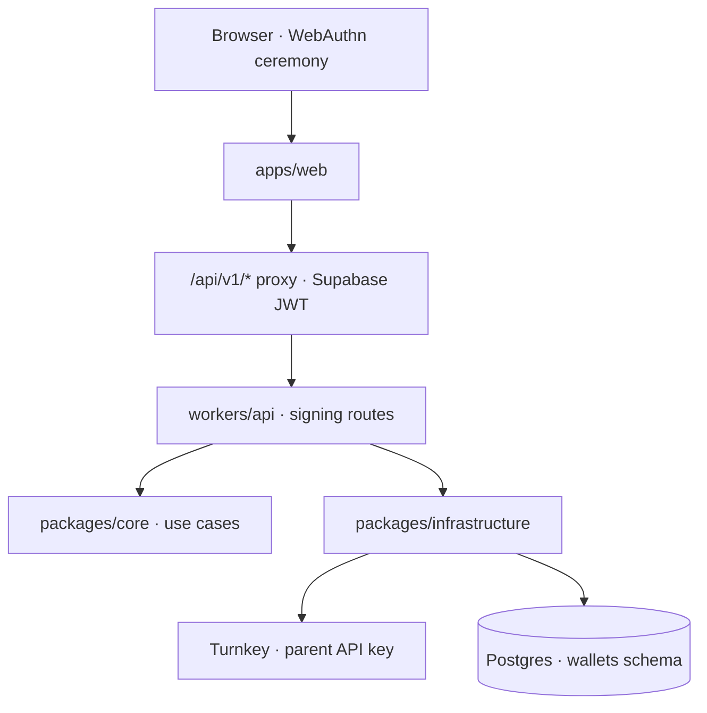

# Turnkey passkey custody — development specification

Design source: `Pickler Auth Passkey Flow.dc.html` (Claude Design project `c03aadb4-7bb2-429e-aa49-98ae4218bc1f`), read through DesignSync.
Code source: Relayer `develop` at `bb6bb1226e92`, the same commit the extraction reports read.
Target: `packages/core`, `packages/infrastructure`, `workers/api`, `apps/web`.

This is the first of two specifications. This one gives a person a self-custodial wallet. The
second gives their agents bounded sub-wallets; see §11.

## 1. Current state, verified

- `packages/infrastructure/src/turnkey/` holds `turnkey-transport.ts` (stamping verified inside
  workerd, `redirect: "manual"` because `@turnkey/http` sends `redirect: "error"`) and
  `turnkey-activity-forwarder.ts`. There is no sub-organization creation.
- There is no `wallets` schema. The product schemas are `identity`, `agents`, `budget`, `audit`,
  `growth` and `market`, defined in `packages/infrastructure/src/persistence/product/`.
- `apps/web` sign-up is email and password through Supabase, in two steps
  (`sign-up-flow.tsx`, 383 lines). There is no passkey anywhere in the repository.
- `identity.workspaces` has `workspaces_owner_key` unique on `owner_user_id`: one workspace per
  person.
- `packages/chain` already carries Monad mainnet (143), Monad testnet (10143) and the AUSD token
  metadata, each verified on 2026-09-16 against the vendors' docs and by `eth_call`. It has no
  balance reader.
- `apps/web/src/app/auth/callback/route.ts` already exchanges a PKCE code for a session, so OAuth
  needs no new callback.

## 2. Constraints

1. **The passkey is the root user.** The sub-organization is created with
   `rootQuorumThreshold: 1`, the user's passkey as its only authenticator, and `apiKeys: []`.
   Pickler holds no credential inside it. This is what makes the design's claim — _"YOUR KEY.
   NOT OURS"_ — true rather than decorative, and it is the reason the parent key cannot later
   mutate the sub-organization (`ORGANIZATION_MISMATCH`).

   The consequence must be stated plainly: **the sub-organization ships with root-quorum
   default-allow and no DENY guards.** Nothing else can be installed from the parent, and the only
   voter is a passkey the person has just created. That is safe for a single-user quorum holding
   its owner's own funds, which is all this specification delivers, but it is not yet a spending
   limit. Limits arrive with the passkey-signed policy round in specification two, and no interface
   copy in this one may imply a cap exists before then.

2. **Supabase Auth owns identity; Turnkey owns custody.** One row joins them. The handle, the
   profile and every RLS policy stay on `auth.users`. Nothing about who a person is moves to
   Turnkey.
3. **The parent Turnkey key lives only in `workers/api`.** The browser never sees it and
   `apps/web` reaches the API through the existing `/api/v1/[...path]` proxy.
4. **Record provenance.** Every ported file opens with
   `// Ported from Relayer <path> (commit bb6bb1226e92).` and states any deliberate change.
5. **Drizzle owns migrations.** `npm run db:generate` then `npm run db:migrate`. No SQL is added
   under `supabase/`.

## 3. Architecture and boundaries

Core holds the decisions and knows neither HTTP nor SQL. Infrastructure holds the Turnkey and
Postgres adapters. `workers/api` reads requests and maps results, following `routes/profiles.ts`.

## 4. The `wallets` schema

New seventh product schema, `packages/infrastructure/src/persistence/product/wallets.ts`.

| Table                 | Holds                                                | Keys                                       |
| --------------------- | ---------------------------------------------------- | ------------------------------------------ |
| `turnkey_orgs`        | the identity ↔ custody join                          | PK `user_id`; `sub_organization_id` unique |
| `wallets`             | the Master Wallet, later agent wallets               | `wallet_id` unique; FK to `turnkey_orgs`   |
| `wallet_accounts`     | the derived Monad address                            | unique `(wallet_id, path)`                 |
| `passkeys`            | local mirror: label, transports, device type, AAGUID | `credential_id` unique                     |
| `webauthn_challenges` | single-use challenges, five-minute TTL               | PK `challenge`                             |

Two deliberate departures from Relayer, both required by `docs/relayer-extraction/00-plan.md`:

**Challenges live in Postgres, not Redis.** Relayer used `cache-manager`. Workers has no Redis and
KV is eventually consistent, which would break the delete-before-use semantics the ceremony
depends on. `DELETE ... RETURNING` on `webauthn_challenges` gives exactly one consumer. This is
blocker W2 in the extraction report.

**`user_id` is the key, not `integrator_id`.** In Pickler a workspace is already unique per owner,
so the two are equivalent, but the design frames the wallet as the person's and this way
registration does not depend on a workspace existing yet.

One account is derived: `m/44'/60'/0'/0/0`, `CURVE_SECP256K1`, `ADDRESS_FORMAT_ETHEREUM`. Relayer
also derived Solana; report 02 puts Solana out of scope and Monad is EVM.

## 5. Core, adapters and routes

**`packages/core/src/features/wallets/`** — domain (attestation, device type derived from the
AAGUID), ports (`TurnkeyOrgRepository`, `PasskeyRepository`, `ChallengeStore`,
`SubOrganizationCreator`), and use cases `issueChallenge`, `registerPasskey`, `prepareAddPasskey`,
`confirmAddPasskey`. Tested against fake ports.

**`packages/infrastructure/`** — `createSubOrganization` built on the existing transport
(`stampCreateSubOrganization` then `sendStampedRequest`), and Postgres repositories on the pool,
following `PostgresBudgetLedger`.

**`workers/api/src/routes/signing.ts`** mounted at `/v1/signing/passkeys`:

| Route               | Purpose                                                            |
| ------------------- | ------------------------------------------------------------------ |
| `POST /challenge`   | issue a challenge, with `excludeCredentials` for existing passkeys |
| `POST /register`    | create the sub-organization and Master Wallet; idempotent          |
| `POST /add/prepare` | build the unsigned `CREATE_AUTHENTICATORS` for a new device        |
| `POST /add/confirm` | forward the stamped activity                                       |
| `GET /passkeys`     | list this person's devices                                         |
| `GET /wallets/me`   | the master wallet's address and balances                           |

The paths are as `signing.ts` mounts them, which is not what an earlier draft of this table said.
It listed the device list as `GET /` and omitted `GET /wallets/me` altogether — and the device list
was then **never implemented**, so for the whole of the first specification this document described
a route that did not exist. Task 13's account screen was planned against this table, and its brief
repeated the promise as fact; the screen was built refusing to state a passkey count it could not
obtain, and the route was added afterwards. A route table is a claim about the code and is worth
re-reading against `signing.ts` before anything is planned on top of it.

New bindings: `TURNKEY_API_PUBLIC_KEY`, `TURNKEY_API_PRIVATE_KEY`, `TURNKEY_PARENT_ORG_ID`,
`TURNKEY_RPID`, `TURNKEY_APP_NAME`.

### Two list methods, and why they are not one

`CustodyRepository` has `listCredentials` and `listPasskeys`, and the difference is the contract on
failure rather than the columns.

`listCredentials` feeds `excludeCredentials` on a challenge. Its caller catches and degrades to no
exclusions, because a lookup failure must never stop somebody registering — Relayer learned that the
same way. So "this account has no credentials" and "the database did not answer" leave that method
indistinguishable, which is correct for an exclusion list.

`listPasskeys` answers the account screen, which tells a person whether they can still reach their
funds after losing a device. **Errors propagate**: nothing in the repository, the service or the
route catches, and the browser turns a rejection into a `failed` state rather than an empty array.
An empty list for an unreachable database would read as "no passkeys", which is the more alarming
of the two ways to be wrong, and it would look entirely reasonable on screen.

Sharing one method would mean one of the two callers is silently wrong, and it would be the one
that matters. `workers/api/test/signing.test.ts` pins the distinction directly — a repository that
throws must surface as a failed read and not as `[]` — because an untested distinction collapses
back into the first method the next time somebody tidies.

**A defect fixed while porting.** Relayer's `register` writes four tables in sequence without a
transaction, and every intermediate failure path carries a comment reading _"orphan in Turnkey"_.
Because we hold a pool, the four writes go in one transaction: four partial-failure windows become
one. A sub-organization can still be orphaned if Postgres fails after Turnkey succeeds — that is
inherent to writing to two systems — and it is logged with its identifiers for reconciliation.

## 6. The three flows in `apps/web`

`src/features/auth/` becomes a step machine mirroring the design's `STEPS`.

| Flow           | Steps                                             |
| -------------- | ------------------------------------------------- |
| **Sign up**    | `auth` → `code` → `handle` → `passkey` → `wallet` |
| **Sign in**    | `auth` → `code` → `welcome`                       |
| **New device** | `recover` → `approve` → `recovered`               |

The order in sign-up is load-bearing: the OTP creates the Supabase session, the handle creates the
profile, and only then can `register` authenticate to create the sub-organization.

**Entry replaces password with OAuth and OTP.** Google and X through `signInWithOAuth`, and a
six-digit code through `signInWithOtp`. Passwords go away: once a passkey guards the funds, a weak
password protects nothing and adds a surface to recover. Both providers must be enabled on the
Supabase project.

**New device uses the browser's own cross-device transport.** The ceremony is: create the local
passkey, have the server build the unsigned `CREATE_AUTHENTICATORS`, let the phone stamp it, then
forward it. The QR is drawn by the operating system via
`authenticatorSelection.authenticatorAttachment: 'cross-platform'`, not by us. Relayer reached the
same conclusion in its approved `add-passkey-device-chooser` design (decision D2: _"los prompts
biométricos los dibuja el OS"_), and its decision D6 records that this needed no API change.

This settles an ordering question the design leaves open. The design puts _"Save a passkey here"_
after the phone approves, but the new credential must exist before the phone can stamp an activity
that adds it. Relayer's modal already numbers it _step 1 create, step 2 verify_. The three screens
stay; both steps happen inside "Use my phone", so `recovered` arrives with the passkey saved.

**The PRF signer is retired.** `apps/web/src/features/wallet/lib/mera-signer.ts` derives a private
key from a passkey's PRF output, on the same relying party this specification registers passkeys
against, and it asks for _whichever_ passkey the person has for that host. Left in place it would
be a second wallet for the same person, able to take the Turnkey credential — which exists only to
authorise activities — and turn it into key material. Turnkey becomes the only custody path;
`connect` keeps only the injected browser wallet, for a wallet the person already had.

**The board keeps real data.** The design's right-hand column is a self-playing tetris with
invented agent names. `SpawnBoard` already renders from `toAuthBoardData`. It keeps its real data
and takes the design's visual treatment: the same effect without inventing activity that did not
happen.

**The passkey sheet** (`idle` → `busy` → `ok` / `error`) is one component shared by all three
ceremonies.

New dependency in `apps/web`: `@turnkey/webauthn-stamper`.

## 7. Errors and idempotency

Three defences Relayer paid for, ported with their tests:

- **Idempotent replay in `register`.** Without it, a retry from a stale tab minted a second
  sub-organization, broke `.maybeSingle()`, and returned the user to the passkey screen forever.
- **The 23505 race backstop.** Two concurrent submissions both pass the pre-check; the loser hits
  the unique index and is treated as a replay, not a 500.
- **`excludeCredentials`.** The browser refuses a second enrolment on the same authenticator. The
  lookup is best-effort: if it fails, the challenge is still issued.

The browser maps `DOMException` by name — `NotAllowedError` is a cancellation and closes quietly,
`InvalidStateError` means already registered, `SecurityError` is almost always an `rp.id` mismatch
and is logged with that hint. Turnkey messages are sanitised before they reach the interface.

`TURNKEY_RPID` is `localhost` in development and the site domain in production. A wrong `rp.id` is
the most common cause of `SecurityError`; Relayer left that diagnosis in a comment and we keep it.

## 8. Testing

Run with `node --import tsx --test`, the repository's existing harness.

| Layer          | Location                        | Covers                                                              |
| -------------- | ------------------------------- | ------------------------------------------------------------------- |
| Core           | `packages/core/test/`           | replay, expired challenge, wrong owner, double enrolment            |
| Infrastructure | `packages/infrastructure/test/` | repositories and the single-use delete, via `npm run test:supabase` |
| API            | `workers/api/test/`             | routes with injected fakes, following `agents.test.ts`              |
| Web            | `apps/web/test/`                | the base64url helpers and the step machine's transitions            |

Written test-first.

## 9. Out of scope

Agent sub-wallets and their policies (specification two); email recovery, which the design
deliberately leaves off; Solana; the agent-facing parts of `wallet_accounts.chain` beyond Monad.

## 10. Before any of this works in a deployment

Two settings decide whether the flow functions at all, and neither lives in this repository's code.

**The relying party.** `TURNKEY_RPID` is the WebAuthn relying party. A passkey registered against one
domain does not work on another and cannot be migrated — the person must enrol again. It must be the
registrable domain or a suffix of the origin serving the app: serving `app.example.com` with
`TURNKEY_RPID=example.com` works and covers the whole domain; the reverse does not. A wrong value is
the most common cause of `SecurityError`, and nothing in the code can detect it. The design canvas
and the retired PRF signer name different domains, so this must be settled before the first
registration rather than after.

**The email template.** `signInWithOtp` sends whichever the template contains: with
`{{ .ConfirmationURL }}` it sends a magic link, with `{{ .Token }}` it sends a code. **A fresh
Supabase project defaults to the link**, so the six-digit screen has nothing to type and email
sign-in cannot complete. This is the default, not a misconfiguration, and the client cannot detect
or work around it.

Put `{{ .Token }}` in **both** the Magic Link and the Confirm signup templates. `shouldCreateUser:
true` on an address nobody has used is a signup, so the confirmation template may be the one that
fires; editing only Magic Link would leave sign-in working and sign-up broken, which is the worse
failure because it looks fixed. Editing both is correct whichever fires.

Hosted: Dashboard → Authentication → Emails → each template. Local: a `[auth.email.template.*]`
block in `supabase/config.toml` pointing at a file under `supabase/templates/`, then
`supabase stop && supabase start`, because the settings are read when the containers start.
`config.toml` does not reach a hosted project, so both need doing.

This repository already has `otp_length = 6` and `otp_expiry = 3600`. Every
`[auth.email.template.*]` block is commented out and `supabase/templates/` does not exist, so the
local stack currently sends a link.

## 11. Open decisions

- The `welcome` screen shows an AUSD and MON balance. `packages/chain` has the constants but no
  reader, so one viem client is needed. If that slips, the screen ships with the address and the
  balance marked pending rather than invented.
- Whether X (Twitter) OAuth credentials exist for the Supabase project. If not, that button is
  hidden rather than shown dead.

## 11b. Two ways a passkey can exist that authorises nothing

Neither is damage and neither blocks release, but both leave a Pickler credential in someone's
keychain that belongs to no sub-organization, indistinguishable in the operating system's picker
from the one that works.

**A cancelled stamp.** Adding a device is two ceremonies and they cannot be reordered: the local
credential must exist before `prepareAddPasskey` can build the activity the phone stamps. Cancel the
second and the first survives. The honest fix is a server-side adopt-or-prune endpoint — the
browser reports the credential it made, and the server either completes the activity or records
that it should never be trusted.

**A retried registration.** `register` is idempotent and returns the existing account early, which
is the behaviour that stops a retry minting a second sub-organization. The cost is that the
credential the browser made for that retry is discarded unused. `excludeCredentials` prevents a
duplicate on the same authenticator, so this is bounded, but it is the same orphan by another route.

Both are worth closing together, because one endpoint answers both.

## 12. What specification two inherits

Each agent is **not** its own sub-organization. Inside the person's single sub-organization an
agent is a wallet (`type='agent'`, never the master), a Turnkey user holding its own API key
(`ACTIVITY_TYPE_CREATE_USERS_V3`), and a two-of-two policy binding that user to that wallet.
A sub-organization is a root quorum, and that quorum is the person's passkey; separate
sub-organizations would require enrolling the passkey once per agent and would put the agent
beyond the reach of any policy, because Turnkey policies do not cross organizations. The design
draws it this way already: on the final screen _Master · PASSKEY ONLY_ is the root and the agent
hangs beneath it.

Relayer built the pieces and tested them — `buildAgentSigningPolicy`,
`buildAgentSelfDeletePolicy`, `buildCreatePolicyActivity` (documented as _"the unsigned
CREATE_POLICY activity for human-passkey stamping"_), `turnkey-policy.service.ts#buildAgentPolicies`
with over twenty cases, `signoff-rules.service.ts`, and `AgentPolicyMetaRepository`. What is
missing is the wiring: those three builders have no caller outside their tests, and
`AgentPolicyMetaRepository.create()` has none either, while `rule-source.ts`,
`cosigner.providers.ts` and `wallets.service.ts` only read. That is why the extraction report says
nothing writes `agent_policy_meta`. Specification two connects tested builders to agent creation;
it does not design the round.
