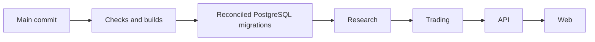

# Coordinated staging deployment

## Implementation and operating state

`.github/workflows/staging-deploy.yml` is the single proposed staging release owner. It responds to
main pushes and explicit workflow dispatch on main. It is **disabled until the repository variable
`STAGING_DEPLOYMENT_ENABLED=true` is configured**. The existing Cloudflare Worker Builds remain the
current owner until the cutover below is completed. This PR does not perform that cutover.

The workflow installs the locked dependencies, checks deployment settings, runs formatting, lint,
types, the full controlled PostgreSQL suite, OpenAPI validation and provisioned staging checks,
then builds all Worker bundles. Only after those pass does it migrate and publish:



All four Workers use the same checked-out SHA, recorded in their version tag/message. Indexer is
compiled by the shared build checks but is not added to this four-Worker release. Admission flags,
runtime provider secrets, trading signer and resource bindings remain in their existing Wrangler
configurations/runtime settings. This pipeline does not enable advice, Perpl paper checks or real
trading, enqueue work or call models.

## Exact GitHub settings

In `Picklerfun/pickler`, create **Settings → Environments → staging**. Limit deployment branches
to `main`. Configure secrets and variables as follows; do not put these in runtime or source files.

| Location                     | Name                                   | Required value                                                                                                        |
| ---------------------------- | -------------------------------------- | --------------------------------------------------------------------------------------------------------------------- |
| Repository Actions variable  | `STAGING_DEPLOYMENT_ENABLED`           | `false` initially; `true` only after cutover                                                                          |
| staging environment variable | `STAGING_WORKER_BUILDS_DISABLED`       | `true` only after independently publishing Cloudflare main triggers are disabled                                      |
| staging environment variable | `CLOUDFLARE_ACCOUNT_ID`                | `bc8d4adf4860284fda426b24e7377bc2`                                                                                    |
| staging environment variable | `NEXT_PUBLIC_SUPABASE_URL`             | Existing staging project's HTTPS origin                                                                               |
| staging environment variable | `NEXT_PUBLIC_SUPABASE_PUBLISHABLE_KEY` | Same public publishable/legacy anon key currently built into staging web; never a service-role key                    |
| staging environment secret   | `CLOUDFLARE_API_TOKEN`                 | Dedicated reviewed token for deploying the four existing Workers and their bindings in the stated account             |
| staging environment secret   | `DATABASE_MIGRATION_URL`               | Operator direct/session connection to the same Supabase project, port 5432, database `postgres`, no URL TLS overrides |
| staging environment secret   | `DATABASE_MIGRATION_CA_CERT`           | Existing Supabase origin CA certificate, real PEM newlines or escaped `\n`                                            |

The database URL requires operator DDL privileges and is not the Hyperdrive binding or a frontend
credential. A pooler username must be `postgres.<project-ref>`; a direct host must be
`db.<project-ref>.supabase.co`. The public Supabase origin and operator connection must identify
the same project. No local OAuth session is uploaded to CI as a long-lived Cloudflare token.

Secrets are scoped to preflight and release steps. Tests use the disposable PostgreSQL service;
builds receive public web variables only. The release adapter omits the Cloudflare token from the
migration child and omits migration credentials from Worker deployment children. Never print secret
values in logs, summaries or artifacts.

## Cutover procedure

1. Review and merge the pipeline PR while `STAGING_DEPLOYMENT_ENABLED` is absent/false. Existing
   Cloudflare builds continue; the new release job is skipped.
2. Configure the `staging` environment, main-only branch policy, secrets and public variables.
   Existing runtime secrets are not copied to GitHub. Confirm the new token's permissions against
   the committed Worker bindings; presence alone does not demonstrate valid permissions.
3. Let current Cloudflare main builds finish. In each of API, Research, Trading and Web, disable
   the independently publishing main trigger before opening the new release gate. Preserve any
   presentation-only web PR previews and their isolated bindings. No preview may run migrations.
4. Set `STAGING_WORKER_BUILDS_DISABLED=true` in the environment to record the completed cutover.
   This value is an operator assertion, not an API audit of the Cloudflare trigger settings.
5. Set repository `STAGING_DEPLOYMENT_ENABLED=true` and dispatch **Coordinated staging deployment**
   on `main`. The dispatch uses the branch SHA; it does not allow an arbitrary commit input.
6. Verify the release artifact, all four active versions and public web/API transport. Subsequent
   main pushes then use the same coordinated process automatically.

Running a separate migration workflow while leaving Cloudflare auto-deploying in parallel does
not enforce migration-before-deployment. Do not enable both owners. A cutover may briefly pause
automatic publishing; it does not interrupt the currently active Worker versions.

## Failure, concurrency and recovery

The workflow serializes releases without cancelling an in-progress migration/publication. Just
before migration, the adapter verifies the checkout and remote main SHA; obsolete queued releases
fail before writes. Main can advance during a running release; it does not make deployment atomic.

The existing migrator uses one transaction, advisory locks, SQL identity/history checks and no
schema resets. Missing known migrations are applied once; a repeat is a no-op. Hosted migration
connections verify the certificate/hostname and reject transaction poolers, unknown hosts and URL
TLS/endpoint overrides. Lock and statement limits fail rather than waiting indefinitely.

A migration failure stops every deployment. A Worker failure stops subsequent Workers and records
the already published ones in `.data/staging-deployment.json`, uploaded with the generated OpenAPI.
Successful migrations and earlier Worker deployments are not rolled back automatically. Inspect
the partial release and database compatibility before dispatching again; no provider call or
destructive rollback is part of recovery. Cancellation stops further phases. Additive migrations
must remain compatible with previously active Workers; destructive schema changes need a separate
expand/contract release plan.

## Local controlled checks

```sh
node --import tsx --test packages/infrastructure/test/migration-connection.test.ts
node --import tsx --test packages/infrastructure/test/migration-history.test.ts
node --test scripts/cloudflare/deploy-staging.test.mjs
npm run format:check
npm run lint
npm run typecheck
```

`npm run deploy:staging` defaults to `--check`; actual publication requires `--run` and the gated
main GitHub Actions context. Controlled tests inject command results and never invoke deployment.

See [staging operations](cloudflare-staging.md), [legacy/current Worker Builds settings](../scripts/cloudflare/README.md),
[Cloudflare GitHub Actions](https://developers.cloudflare.com/workers/ci-cd/external-cicd/github-actions/)
and [GitHub deployment controls](https://docs.github.com/en/actions/how-tos/deploy/configure-and-manage-deployments/control-deployments).
