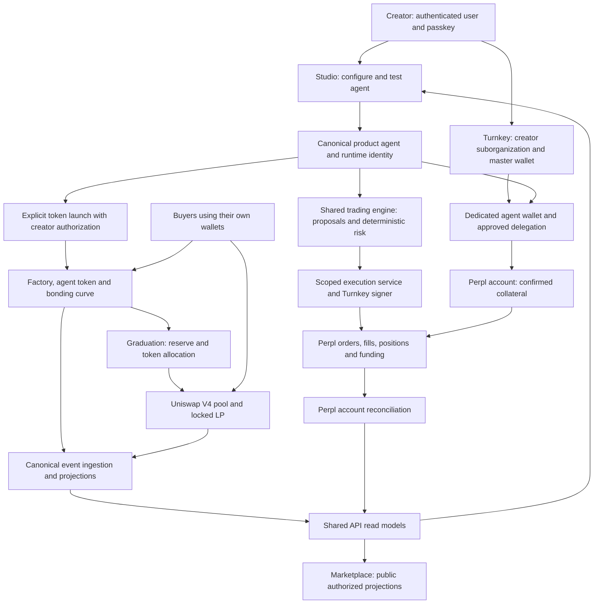
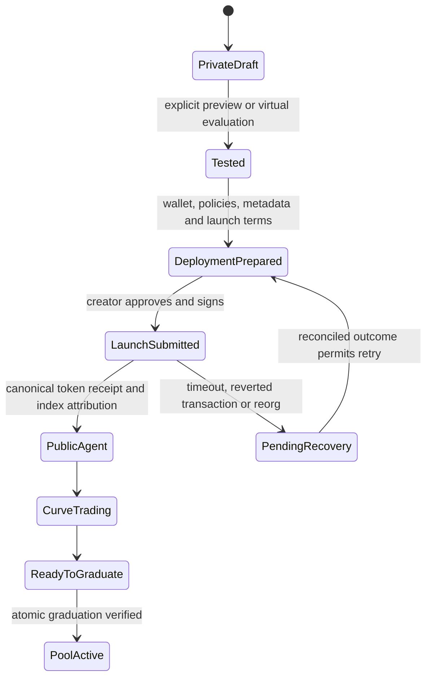

# Studio, custody, Perpl and launchpad integration review

Status: current implementation map and proposed follow-up plan, not an execution runbook.
Updated on 2026-10-01 against main `7e7ff5f6fa82e17dab53639a7b180eecde72b41b`.
The original three-agent static audit was conducted on 2026-09-29 against
`4b4bd2662d4d6597aaee6b0f5cdaf26c1c361704`, with PR #61 separately inspected at
`faa3294ccf679fcacab5d6101b96f4f6f1203d21`. Those revisions remain historical provenance;
they are no longer the operational baseline. This update reconciles the findings with merged
PRs #61, #66, #67 and #68 and the open Perpl stack. No new runtime, security, remote-provider
or deployment acceptance is claimed by this documentation update.

Code dependency rules remain in [Trading architecture](trading-architecture.md). This document
maps product transitions and remaining integration work; it does not replace those rules.

## 1. Repository handoff

| PR                                                                                                                                                               | State at this update                          | Integration meaning                                                                        |
| ---------------------------------------------------------------------------------------------------------------------------------------------------------------- | --------------------------------------------- | ------------------------------------------------------------------------------------------ |
| [#40](https://github.com/Picklerfun/pickler/pull/40), [#37](https://github.com/Picklerfun/pickler/pull/37), [#59](https://github.com/Picklerfun/pickler/pull/59) | Merged                                        | Custody/Studio wallets, launchpad foundation and shared trading extraction                 |
| [#61](https://github.com/Picklerfun/pickler/pull/61)                                                                                                             | Merged                                        | Private drafts, preview runs, PostgreSQL product adapters and reconciled preview migration |
| [#66](https://github.com/Picklerfun/pickler/pull/66)                                                                                                             | Merged                                        | Full block-batch continuity validation; not complete indexer recovery                      |
| [#67](https://github.com/Picklerfun/pickler/pull/67), [#68](https://github.com/Picklerfun/pickler/pull/68)                                                       | Merged                                        | Degraded public reads and error/offline/wrong-network presentation                         |
| [#60](https://github.com/Picklerfun/pickler/pull/60)                                                                                                             | Open, conflicts with main                     | Market-frame validation and shared campaign budgets; requires reconciliation               |
| [#63](https://github.com/Picklerfun/pickler/pull/63)                                                                                                             | Draft, based on #60; integration check failed | Data-gap recovery and interrupted-writer fencing                                           |
| [#69](https://github.com/Picklerfun/pickler/pull/69)                                                                                                             | Open, based on #63; published checks passed   | Measured REST/WebSocket acquisition and public diagnostics; not integrated into main       |
| [#70](https://github.com/Picklerfun/pickler/pull/70)                                                                                                             | Open, owned by the other UI/auth session      | Studio-host authentication callback; not part of audited main                              |
| [#65](https://github.com/Picklerfun/pickler/pull/65)                                                                                                             | Open; format check failed                     | Proposed product scope/specifications; not current implementation authority                |

The Perpl integration order is #60 → #63 → #69. Checks on a stacked branch do not establish
acceptance against current main; reconcile each base and validate the combined result. The
other session owns acquisition, diagnostics and public stability testing. This audit does not
change its branches, historical studies, paid budgets or processes.

PR #69 reports a ten-minute comparison (REST 10/10, WebSocket 10/10) and thirty-minute public
acceptance (30/30 joint cycles, zero lease failures), selecting REST because availability tied.
Its measured revision is `01ee0c31e1a11207674f46dc5631bd8efde61ff6`; its recorded PR head is
`0bcdfd418e834490f61a6bf99a24c0474236917f`, which includes later controlled fault coverage.
These are the other session's reported measurements, not a new validation performed by this
update, proof of every historical failure's cause, or a paid strategy comparison.

Our historical evaluation checkout remains pinned at `4b78834`; previous attempts and results
remain evidence, not current operational instructions. This review is maintained on
`codex/wallet-perpl-audit`, separately from those studies. The old `codex/shared-jev-client`
branch was previously verified patch-equivalent to main and needs no duplicate publication.

## 2. What exists, and what is missing

| Area                    | Implemented on audited main                                                                    | Missing connection or qualification                                                                        |
| ----------------------- | ---------------------------------------------------------------------------------------------- | ---------------------------------------------------------------------------------------------------------- |
| Creator custody         | Supabase identity, Turnkey suborganization, passkey root and master wallet                     | Remote configuration and real ceremony acceptance were not established here                                |
| Agent wallets           | Separate wallets inside the creator's suborganization, approved policies and unique agent link | No Perpl account mapping or delegated Perpl signer                                                         |
| Funding                 | Passkey-approved AUSD transfer from master to agent wallet                                     | Exchange collateral deposit and receipt/finality reconciliation                                            |
| Agent execution         | Shared research runtime, Polymarket paths, Perpl virtual evaluation                            | Studio cannot yet create/run a Perpl agent                                                                 |
| Creator spending limits | Persisted per-call/per-day values                                                              | `spendEnforced: true` describes paper limits; no live Turnkey/Perpl enforcement                            |
| Marketplace             | Agent directory reads PostgreSQL                                                               | Perpetual market board uses sample data; trade ticket cannot submit                                        |
| Launch contracts        | Fixed-supply token, factory, curve, V4 graduation, locker, fee escrow                          | No Pickler deployment manifest/scripts or end-to-end launch ceremony                                       |
| Launch API              | Public catalogue/detail/trades reads                                                           | No launch, quote, buy/sell or graduation preparation/submission                                            |
| Indexer                 | Raw blocks/logs, full batch continuity, transactional cursor persistence and reorg marking     | Child emitters, composed projector, automatic projection rollback, attribution and full market projections |

Turnkey owns key custody and policy-controlled signing. Perpl is an exchange account/position
system, not the custodian of the creator's Turnkey wallets. A wallet funded with AUSD does not
therefore have Perpl collateral. The term “child wallet” describes our product relationship:
the implementation creates independent wallets in one suborganization, not wallets derived from
master-wallet keys. A single delegated platform public key is registered for the creator's
non-root Pickler user; it is not currently a separate key per agent.

Evidence:
[wallet schema](../packages/infrastructure/src/persistence/product/wallets.ts),
[Turnkey provisioning](../packages/infrastructure/src/turnkey/turnkey-sub-organization.ts),
[agent creation transaction](../packages/infrastructure/src/studio/directory.ts),
[delegated policies](../packages/core/src/features/wallets/domain/agent-wallet-policies.ts),
[Studio routes](../workers/api/src/routes/studio.ts),
[marketplace composition](../workers/api/src/growth/services.ts).

## 3. Proposed business flows and authorities

This is the target map, not a claim that every arrow runs today.

Each fact has an explicit authority; “one source of truth” does not mean one table owns
identity, private keys and exchange balances:

| Fact                                                 | Authority and owner                                                      |
| ---------------------------------------------------- | ------------------------------------------------------------------------ |
| Identity, tenant membership, agent configuration     | Product/runtime records; core authorization, infrastructure persistence  |
| Key control, root consent and delegated signing      | Turnkey policies; custody application ports and infrastructure adapters  |
| Strategies, order admissibility and financial risk   | `@pickler/trading`; runtime composes model/provider plugins              |
| Actual token supply, curve reserve, pool and fees    | Deployed contracts and canonical chain receipts/events                   |
| Actual Perpl collateral, orders, fills and positions | Perpl contracts/account state, reconciled through its adapter            |
| Marketplace prices, candles, holders and status      | Rebuildable projections of authorized canonical sources, with watermarks |
| LLM cost                                             | Separate USD usage/reservation ledger                                    |

Persist an explicit binding across user, workspace, tenant, product agent, runtime agent,
Turnkey organization/wallet/address, chain ID, venue account, and launch agentKey/factory/token.
No component may infer this binding from ticker, display name or unsigned metadata.

### Agent lifecycle

Main contains one creation journey, persisted:

| UI entry                | Current behavior                                                                             | Wallet/token outcome                                                        |
| ----------------------- | -------------------------------------------------------------------------------------------- | --------------------------------------------------------------------------- |
| `/studio` create screen | Create and fund the agent wallet, then "Create" signs its policies and saves a private draft | Linked, funded agent wallet; no token or completed public-launch transition |
| Draft home “Go public”  | Visual panel whose steps are marked SOON and whose button is disabled                        | No publication operation                                                    |

There is one creation flow (`/studio/new` and the brief's paper run are gone): the wallet is
made and funded first, then the draft is created with it. Creating a wallet-backed draft does not
prove public deployment, token creation or Perpl execution. Evidence:
[create screen](../apps/web/src/features/studio/new-agent/new-agent.tsx),
[wallet-first ceremony](../apps/web/src/features/studio/new-agent/ceremony.ts) and
[disabled publication panel](../apps/web/src/features/studio/home/go-public.tsx).

Proposed unification: use one persisted agent identity from draft through publication. Keep
step-by-step configuration only as another editor for that same draft, then prepare/reconcile
wallet and token provisioning during explicit publication. This remains a product proposal;
the owner has requested clarification but has not yet fixed token timing or the final UI flow.

Proposed lifecycle, pending the creator's choice about launch timing:

Recommendation: token creation belongs to public deployment, while private drafts can be tested
without an on-chain token. If every persisted agent must instead have a token, adjust admission
and recovery explicitly; do not silently impose that rule on existing private drafts.
Venue trading permission remains a separate state: public token status does not authorize Perpl
trading, and a stopped Perpl strategy must not erase its token's market or history.

### Money boundaries

Keep all of these separate in storage and UI:

1. Creator and agent wallet balances, including native gas.
2. Confirmed Perpl collateral, equity, reserved margin and withdrawable balance.
3. Virtual paper capital and results.
4. Token curve reserve and token inventory.
5. Permanently locked DEX liquidity principal.
6. Creator/protocol accrued and claimable fees.
7. Model cost in USD.

Buying an agent token does not automatically fund its Perpl account or confer a claim on its
trading P&L. The current contracts do not implement that relationship. Any future treasury or
fee-to-trading allocation requires a separately authorized, recorded flow; curve and LP reserves
must not become trading capital.

## 4. Endpoint inventory

These are API paths on audited main; the web forwards `/api/v1/*` to `/v1/*`.
Existence in source does not prove a route is mounted/configured in a deployed environment.

| Operation               | Existing endpoint family                                                                                                                                   | Status                                                      |
| ----------------------- | ---------------------------------------------------------------------------------------------------------------------------------------------------------- | ----------------------------------------------------------- |
| Profile/session         | `GET /v1/auth/me`, `GET/POST /v1/profile`                                                                                                                  | Authenticated user                                          |
| Master wallet           | `POST /v1/signing/passkeys/{challenge,register}`, `GET /v1/signing/wallets/me`                                                                             | JWT; conditional Turnkey mount                              |
| Additional passkey      | `GET /v1/signing/passkeys`, `POST /v1/signing/passkeys/add/{prepare,confirm}`                                                                              | User passkey ceremony                                       |
| Agent delegation/wallet | `GET /v1/signing/agents/state`, `POST /v1/signing/agents/{delegated,wallet}/{prepare,confirm}`                                                             | JWT and exact stamped activities                            |
| Agent policies          | `POST /v1/signing/agents/wallet/:walletId/policies/{prepare,confirm}`                                                                                      | Own wallet, server-owned policy terms                       |
| Agent creation/read     | `GET/POST /v1/studio/agents`, `GET /v1/studio/agents/:id`                                                                                                  | Scoped identity and approved wallet                         |
| Model drafting          | `POST /v1/studio/agents/draft`                                                                                                                             | Model-based drafting; not a saved private draft             |
| Funding wallet          | `POST /v1/studio/agents/:id/deposit/{prepare,confirm}`                                                                                                     | AUSD wallet transfer, not exchange collateral               |
| Controls                | `PUT /v1/studio/agents/:id/{config,limits,interval,pause,schedule}`                                                                                        | Research controls; stored spend limits not live enforcement |
| Research                | `GET/POST /v1/studio/agents/:id/runs`, `GET /v1/studio/runs/:id`, `GET /v1/studio/runs/:id/events`                                                         | Shared research runner                                      |
| Existing trading        | `/v1/studio/agents/:id/trading/*`, `GET /v1/studio/trading/orders/:id`, `POST /v1/studio/trading/orders/:id/submit`, `POST /v1/studio/runs/:id/live-order` | Polymarket-specific, not Perpl                              |
| Public product          | `GET /v1/marketplace/*`                                                                                                                                    | Agent directory persisted; perpetual markets sampled        |
| Token catalogue         | `GET /v1/launches`, `GET /v1/launches/:id`, `GET /v1/launches/:id/trades`                                                                                  | Reads only                                                  |

Main also implements `POST /v1/studio/preview-runs`, `GET /v1/studio/preview-runs/:id`,
and `POST /v1/studio/drafts`. Preview runs use the real research runtime and require admission;
“paper” does not mean free model calls. Draft adoption preserves the completed preview rather
than launching a token or creating an agent wallet.

Missing API use cases to specify before implementing routes: publish/launch preparation and
status, token quotes and transaction preparation, graduation status/preparation, venue-account
onboarding, Perpl collateral/withdrawal, order admission/status/cancel and account reconciliation.
Keep custody and venue execution distinct; do not expose a generic arbitrary-signing endpoint.

## 5. Findings that block end-to-end acceptance

### Custody and Perpl

- `VENUE_CONTRACTS` is empty, so the delegated user has no venue-signing ALLOW. Existing DENYs
  block ERC-20 transfer/approve and privilege escalation. Filling an address list is insufficient:
  define chain, account, contract methods, caps, nonce handling and revocation first.
- `workers/trading` currently uses a static Polymarket signer and credentials. It does not route
  agent Turnkey wallets into Perpl. Perpl has read-only tools and a virtual simulator only.
- Deposits record broadcast hashes, not confirmed exchange credit. Include chain ID, receipts,
  finality, reorg and orphaned external-effect recovery in the funding state machine.
- Review delegated-key blast radius and rotation: one configured platform key serves multiple
  creator suborganizations. Document what can be revoked per creator and per agent.

### Contracts and launch attribution

- Factory enforces one token per nonzero `agentKey`, but `_authorize` authenticates the supplied
  creator without checking a creator namespace for that key. Another creator can provide the
  same intended key first. This static finding requires a failing impersonation test and a
  canonical authorization/derivation design before deployment.
  Evidence: [factory](../contracts/src/PicklerLaunchFactory.sol), lines 146–160 and 258–275;
  the [development specification](specs/launchpad-monad-v1.md) requires creator namespacing.
- A Turnkey transaction builder exists internally, but public custody use cases currently only
  authorize the fixed wallet deposit. There is no launch-signing composition, deployment
  manifest, or product-agent-to-agentKey implementation.
- Graduation logic exists: release protected reserve and LP token allocation, initialize/verify
  a V4 pool, mint and lock liquidity atomically. The locker permits fee collection, not principal
  withdrawal. This is implemented code with historical tests, not a deployment acceptance claim.
  See [adapter](../contracts/src/PicklerGraduationAdapterV4.sol),
  [curve](../contracts/src/PicklerBondingCurve.sol) and
  [locker](../contracts/src/PicklerLiquidityLocker.sol).

### Indexer and public truth

- The [Worker](../workers/indexer/src/index.ts) composes one factory source and no projector.
  [Log acquisition](../packages/infrastructure/src/chain/launch-indexer.ts) filters only that
  source address. Curve trades, adapter graduation, token transfers, fees and subsequent pool
  swaps need explicit discovery and collection, including the creation/graduation block itself.
- The [projector](../packages/infrastructure/src/persistence/product/launch-projector.ts) writes
  `agentId: null`; there is no completed authoritative attribution flow. It has no candle/holder
  or V4-swap projection path. Metadata reading is injected but not composed in the Worker.
- Raw reorg marking does not reverse previously published tokens/pools/trades. The current
  [reorg projection test](../packages/infrastructure/test/launch-projector.test.ts) manually
  deletes trades before rebuilding; it does not validate automatic correction of public views.
- [Block advance](../packages/core/src/features/launch/domain/indexing.ts) now validates every internal height/parent as well as the cursor boundary, including bootstrap
  and overlap. PR #66 rejects gaps without applying a prefix and fails duplicate heights or
  mixed ancestry without requesting a rollback of persisted history. A coherent replacement
  of the persisted anchor still uses the reorg path. Its regression tests cover unchanged
  PostgreSQL cursor/events/outbox after invalid input, then a valid continuation. This does
  not fix caught-up reorg detection, concurrency or derived projection rollback.
  [Persistence](../packages/infrastructure/src/persistence/product/launch-index-store.ts) needs
  concurrency fencing and consistent chain/stream rollback when adding multiple sources.
- [Freshness](../packages/infrastructure/src/persistence/product/launch-read-model.ts) derives
  from a raw cursor and labels it confirmed; it must instead expose projection progress and the
  effective finality policy. A high cursor from one source is not completeness of all streams.

### Studio integration after PR #61

- The brief/preview path is implemented for Polymarket sports research; Perpl execution is
  still absent. Leverage vocabulary in a brief does not change the configured protocol.
- Product repositories now use the invocation PostgreSQL pool; Supabase remains for auth.
  The old mixed product-data ownership is historical, not an outstanding migration proposal.
- Preview tables are integrated through `0022_studio_preview_runs.sql`, after the existing
  custody/launch history. The old branch's `0017` collision is resolved. Preserve published SQL,
  hashes, migration timestamps and historical results on subsequent changes.
- Financial ownership remains in `@pickler/trading`; the old branch's retired core imports
  must not be restored. `evaluate` remains the sole evaluation entry point.
- Main exposes `SPEND_ENFORCED = true` for paper spending controls. That flag is not proof of
  live wallet-policy caps or Perpl account/order limits; those still need explicit acceptance.
- #67/#68 improve unavailable/error presentation. Their error messages preserve uncertainty
  about earlier transactions and agent execution; a page error cannot prove nothing moved.
- Decide how private drafts acquire wallet, token and publication. “Go public” remains disabled,
  and neither creation journey currently launches the agent token.
- The cross-host callback correction in #70 remains separate work; this review does not mark
  its UI, session cookies or remote authentication journey as accepted.

## 6. Delivery plan and ownership

The audit findings are reconciled to the pinned main revision. The delivery stages below remain
proposed. Use separate reviewable branches from current main, integrating one owner at a time for shared files.

| Stage                         | Owner/scope                                         | Deliverable and acceptance gate                                                                                                                           |
| ----------------------------- | --------------------------------------------------- | --------------------------------------------------------------------------------------------------------------------------------------------------------- |
| A. Product contracts          | Coordinating session with product/custody reviewers | Agreed unified lifecycle, identity bindings, money map, endpoint and permission matrix; preserve the integrated #61 migration history                     |
| B. Launch safety and identity | Contract/custody review                             | Canonical agentKey authorization, replay protection tests, network manifest and explicit creator-signing intents; no token squatting                      |
| C. Indexing completeness      | Indexer review                                      | Multi-emitter ingestion, projector composition, fencing, full reorg recovery and attribution; replay yields identical API state without manual deletes    |
| D. Launch experience          | API/Studio/marketplace review                       | Prepare/sign/submit/reconcile for publish, quote, buy/sell, graduation and fees; one UX with explicit pending/reverted/finalized states                   |
| E. Perpl account integration  | Trading/custody review                              | Wallet-to-venue binding, root funding, restricted delegated execution and real limits; reconcile #60/#63/#69 and validate the combined acquisition module |
| F. Testnet acceptance         | Coordinated operator release                        | Verified manifests, deployed bytecode, indexer backfill and full user journeys with controlled amounts and recorded receipts                              |
| G. Paid comparison/live pilot | Separate measured acceptance                        | New comparison window only after reliability; real Perpl activity separately authorized and reconciled                                                    |

B and C can be developed independently after A fixes the identifiers, ABI expectations and state
contracts. D depends on B/C. E can proceed independently of token liquidity, but relies on shared
identity/custody and the other session's data service. F is not an automatic deployment triggered
by this document or a merge.

The agents for the next review should retain distinct responsibilities: custody/permissions;
Studio/API/product lifecycle; contracts/economics; indexer/projections; Perpl/execution. With a
four-agent concurrency limit, run three review specialists plus a coordinator in two waves.
No two sessions should edit the same cross-cutting migration, DTO or composition file concurrently.

### Required acceptance journeys

1. Two creators, two agents each: all cross-owner wallet, scope, token and venue operations fail.
2. Interrupted wallet/policy/agent provisioning resumes or reconciles without duplicate effects.
3. Private draft stays private; public deployment creates exactly one attributed token and never
   treats a transaction hash as finality. A launch failure does not destroy the private agent.
4. Buyers quote/sign/buy/sell on the curve with min/max bounds and deadlines; limits/fees match
   Solidity and actual receipts. Do not substitute the current visual ticket arithmetic.
5. Exhaust allocation, graduate once, trade through the resulting pool, collect and claim fees;
   a failure leaves protected reserves intact and does not fabricate pool activation.
6. Replay all sources from deployment; handle duplicates, same-block creation/trades, internal
   batch reorgs, post-graduation reorgs, concurrent cron and RPC outages. Assert API projections,
   holders, candles, fees and attribution, not merely raw-log counts.
7. Fund wallet, then separately fund Perpl; place/cancel/reconcile, close and withdraw under
   explicit authority. Wrong network, excess amount, revoked policy and ambiguous send fail safely.
8. Verify wallet/venue/paper/model/curve/LP/fee balances remain separate; neither token market cap
   nor token purchases become automatically spendable Perpl capital.
9. Validate current-main and pending-branch migration histories, then full relevant tests,
   types, formatting, architecture checks, service/Worker builds and Solidity unit/fuzz/invariant
   tests. Run fork and testnet checks only as explicit gates with pinned network evidence.
10. Update each affected `AGENTS.md` alongside implementation; mark historical validation records
    by commit and preserve their evidence. Architecture diagrams and UI labels must match actual
    callable features, not specifications of future work.

## 7. Liquidity recommendation and network gate

Recommended architecture: curve trading first, then the existing atomic V4 graduation design.
Pickler can retain the buy/sell interface and construct transactions for users before and after
graduation; the DEX pool supplies post-graduation execution. Building a separate exchange or
having Pickler trade its own agents' tokens is not necessary to complete this flow. If proprietary
market-making is later desired, treat it as a separately funded, disclosed strategy with explicit
inventory limits; it must not spend locked liquidity or be presented as organic demand.

This is an engineering recommendation, not a claim about token returns or liquidity sufficiency.
Review preset economics, launch eligibility, fees and the irreversible LP lock before deployment.

The recorded [V4 spike](market/uniswap-v4-spike.md) used a Monad-maintained testnet deployment,
not an official Uniswap testnet deployment. That historical evidence does not establish current
addresses or code. Select the testnet V4 deployment explicitly, reverify chain/code hashes and
compiler/ABI compatibility, and record the choice. Official deployment addresses vary by network.
Perpl's exchange deployment and its collateral token require their own verified network manifest;
never assume the Studio default testnet or its AUSD address matches the chosen exchange.

Official references consulted in the original 2026-09-29 static review (not revalidated by this update):

- [Turnkey suborganizations](https://docs.turnkey.com/features/sub-organizations): user/org custody
  boundary and root authority; parent visibility alone is not signing permission.
- [Perpl SDK](https://github.com/PerplFoundation/dex-sdk/tree/main/crates/sdk): exchange state and
  order construction; the caller provides signing. Account state is separate from key custody.
- [Uniswap V4 deployments](https://developers.uniswap.org/docs/protocols/v4/deployments): choose and
  verify contracts per network, rather than reusing an address from another chain.

## 8. Decisions still needed

- Token timing: public deployment (recommended) versus every agent creation, including drafts.
- Testnet DEX deployment and verified contracts/versions; no automatic deployment approval.
- Approved launch preset, quote asset, creator fee recipient, gas payer and irreversible lock policy.
- Scope of the first Perpl integration: supported chain/account model and root/delegated operations.
- Confirmation of what a token represents. The current implementation promises no ownership of
  the agent wallet, revenue share or claim on Perpl P&L; any such product feature needs its own design.
