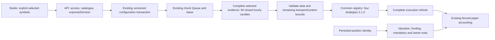

# Agent-selected Perpl markets

## Current boundary

Studio uses the public Perpl context for the configured Monad network. The shared pure identity
parser is in `@pickler/perpl-context`; the strict metadata reader and HTTP transport remain in
infrastructure. The mobile context parser retains its separate contract. No manual product
market list or additional strategy engine is introduced.

`GET /v1/studio/perpl/markets?network=testnet|mainnet` requires the existing Studio user access.
Through Web the path is `/api/v1/studio/perpl/markets`. Responses contain network, observation
time, market identity, symbol, collateral, open/closed/invalid status, compatibility and reasons.
Execution identifiers are informational and never accepted as creation/setup input. Compatibility
requires an unambiguous canonical symbol and market id, valid required metadata and six-decimal
AUSD collateral. Closed markets and negative taker fees cannot be selected. If the complete
strict context has malformed rows or duplicate ids, no row is advertised as execution-compatible.
Other read transport, freshness, precision, fees and funding rules are unchanged.

Creation requires explicit nonempty `markets`. The server selects the network from its configured
wallet chain, not the submitted body. New agents use Perpl configuration v2 and
`combined@2.1.0`. Setup accepts optional `markets` with `expectedVersion`, validates a fresh
catalogue for the saved network, records the existing configuration history, advances the version,
invalidates preparation and disables scheduling. Editing markets upgrades the chosen strategy id
to `2.1.0` in the same save. A symbol never becomes selected simply because Perpl lists it.

Configuration v1 remains restricted to BTC/ETH and is readable without backfills. Agents untouched
by a market edit retain their previous configuration and strategy version. Laboratory `1.0.0`,
Studio `2.0.0` and their prompts/results remain distinct from dynamic Studio `2.1.0`. Advice remains
BTC/ETH only. Version 2.1 shares the existing SMA, Jev support/material-veto, creator sizing and
financial policies; model adapters use versioned dynamic-symbol prompts and response schemas.

## Decision and exit flow

The selected set authorizes new exposure. The independently supervised set also contains recorded
position symbols. Removing a symbol prevents new openings and pending approvals, but does not
remove its marks, funding or reducing exits. New product positions retain their full buy-time
market identity in their existing JSON document. Trusted position reads pin ids, exchange,
collateral and decimal precision; a relisting cannot silently replace a position's market. If a
market disappears from the catalogue, the recorded public endpoints may still be queried for a
close; unavailable endpoints remain explicit errors. Historical positions without recorded
metadata are not rewritten and retain their strict unambiguous-symbol reader.

All selected markets must have valid mandatory evidence before paid sources/models. The existing
24-request public session cap is shared by selected and held reads. Oversized sets fail explicitly;
no budget is increased and no partial model analysis or paid retry occurs. Version 2.1 projects
at most ten web documents, each bounded to 4,000 serialized UTF-8 bytes inside the existing
4,000-character limit. A pure model-input preflight reserves room for a bounded 50,000-byte actions
array in combined review; an oversized generated result is a format failure, never another call.
Actual prompt/request content and hashes are recorded through the existing USD call ledger.

Funding, fees, sizing, reservations, cancellation, leases, configuration checks and transactional
ownership remain owned by the existing engine and repositories. Funding/lease/data failures do
not become hold proposals. Wallet funding and saving markets do not activate the runtime.

## Studio states

Sources & rules contains the shared **Trading markets** selector in creation, drafts and published
agents: fixed network, search, multiple selection and unavailable reasons. No real default is
selected. Loading uses Skeletons, leaves the form mounted and preserves selection. Failed or
expired catalogues offer retry and cannot admit changed markets; unrelated setup fields can still
be saved. A missing listing remains visible in selected chips and can be explicitly removed.

Console displays saved selected symbols. Runtime loading, read failure with retry, confirmed
runtime disablement and available paper checks are separate states. A failed read is never
presented as a successful disablement. Chat has no submission/actions and explains that paper
checks belong to the existing engine.

## Migration and deployment

Migration `0033_perpl_dynamic_markets` changes only the existing proposal instrument CHECK from
BTC/ETH to the canonical symbol pattern. It adds no tables and updates no historical rows.
Run the infrastructure migrator before deploying the new product consumer; never rewrite 0027
or bypass the constraint with a surrogate BTC/ETH value. Normal coordinated release migration
controls still apply. This delivery applies it only to disposable local acceptance databases.

## Validation and reproduction

Run shared builds, root tests against isolated PostgreSQL, types, lint, format, architecture,
OpenAPI export and Worker builds. See [controlled Studio acceptance](studio-acceptance.md) for the
compiled Web -> API -> Queue -> strategy -> PostgreSQL -> UI journey using BTC/SOL and all four
2.1 strategies. The alternate fixed Supabase slot (`prepare alternate`, 55531/55532) preserves an
already running controlled stack; ordinary local and remote databases remain refused.

Targeted coverage lives in infrastructure `perpl-catalog`, core `studio-revise`, trading
`studio-perps-strategies`/`perps-paper-product`, runtime `studio-perps-models`, API
`studio-draft-routes` and the real PostgreSQL runtime/action suites. Preview fixtures demonstrate
presentation only and are never evidence of provider or deployed readiness.

Remote activation remains pending: verify deployed migration/configuration, public Perpl markets,
real passkeys/providers and explicitly reviewed models, tariffs and USD limits. No deployment,
paid call, real transfer/order, strategy threshold change or activation is part of acceptance.

## Delivery acceptance record

The complete compiled four-account journey passed against source commit
`843b6e843d3a52b0b9ddf9f895eae927cda29b31` on 2026-10-07T00:56:13.988Z. The delivery documentation
commit follows that source without changing executable code. Base main was
`29f4ba62ce4d554245070109c27ea33dbfbb8a07`. Private evidence remains outside Git in the
identity-fenced alternate Supabase stack, under
`runs/1791334163318-141387ef-2e7c-4122-80be-15c428abdebb/acceptance.json`.

Configuration: Monad testnet; explicit BTC/SOL; four independent accounts; version 2.1.0;
five-AUSD creator margin; one-position cap; six manual checks plus one hourly dispatch per
account. Controlled provider usage/tariffs and the zero-rate historical funding anchor are
specified in [Studio acceptance](studio-acceptance.md). The partial stale-data result is reused
as stale-data evidence, rather than admitting a seventh manual check. No production admission
limit or budget was enlarged for the test.

| Strategy | Model order       | Market removed with a position | Remaining selection | Post-removal outcome | Closed positions | Cash oracle (AUSD) |
| -------- | ----------------- | ------------------------------ | ------------------- | -------------------- | ---------------- | ------------------ |
| combined | fallback → review | SOL                            | BTC                 | held                 | 2                | 999.991858         |
| rules    | None              | BTC                            | SOL                 | blocked              | 2                | 999.993054         |
| deepseek | direct            | BTC                            | SOL                 | held                 | 2                | 999.993054         |
| jev      | jev               | BTC                            | SOL                 | blocked              | 2                | 999.993054         |

A `blocked` post-removal result means the unchanged one-position cap rejected new exposure in the
remaining authorized market. It is not a failed check: the removed position remained supervised
and its later paused owner close passed. In each account the partial evidence check failed with
zero model transports, runtime read retry recovered, and final cash matched an independently
calculated integer-lot/book/fee oracle.

| Scenario                                                                                                         | Status             | Evidence boundary                                                                                         |
| ---------------------------------------------------------------------------------------------------------------- | ------------------ | --------------------------------------------------------------------------------------------------------- |
| Catalogue networks, new/closed/missing markets, duplicate identity, invalid collateral/metadata and expired data | Passed             | Captured public wires through the real adapter/parser; controlled route tests                             |
| Required creation selection, unchanged legacy configuration, versioned setup and generic configuration edits     | Passed / corrected | Core and authenticated API; generic legacy edits now upgrade to 2.1.0                                     |
| Four strategies, independent accounts, proposals, approvals, exact fills, holds and signal exits                 | Passed             | Compiled Studio → API → local Queue → existing engine → real isolated PostgreSQL → UI                     |
| Complete evidence and context/transport capacity before paid calls                                               | Passed             | Partial/stale browser journey, runtime preflight and freshness regressions; no real paid calls            |
| Removed-market supervision, pending approval refusal and paused/runtime-disabled owner exits                     | Passed             | Full browser journey plus real PostgreSQL owner-action regression                                         |
| Concurrent saves/admissions, owner isolation, configuration revocation, lease loss and recovery                  | Passed             | Existing affected real PostgreSQL and Worker suites; no duplicate transports or movements                 |
| Reserves, unknown costs and positive/negative/duplicate/pending/corrected funding                                | Passed             | Controlled trading/runtime and real PostgreSQL suites; browser funding anchor separately identified above |
| Console loading, confirmed disabled, read failure/retry and available checks                                     | Passed / corrected | Shared interface states, actual aborted endpoint transport and successful retry                           |
| Dynamic proposal persistence                                                                                     | Corrected          | Migration 0033 applied to disposable databases; no historical changes or new tables                       |
| Real Turnkey policy enforcement/passkeys, public providers, deployed Queue/Hyperdrive and remote migration       | Pending            | Separate deployed acceptance; no remote changes made by this delivery                                     |
| Reviewed remote models, tariffs, USD limits and activation                                                       | Pending            | Explicit operator review required; no feature activation in this delivery                                 |

Validation completed: 2,833 root-suite tests passed, zero failed, one optional generic Worker
flow skipped (the separate full Studio browser journey above did run); types in all 17
workspaces; lint; formatting; architecture/link checks; 185 generated OpenAPI operations;
shared packages, agent service, Web and Workers builds; static design and rendered surface,
token, contrast and typography checks on six affected Studio routes. Root test discovery ran
with four file workers against the disposable loopback PostgreSQL fixture; each integration
suite created and migrated its own isolated database. No hosted database was used.
