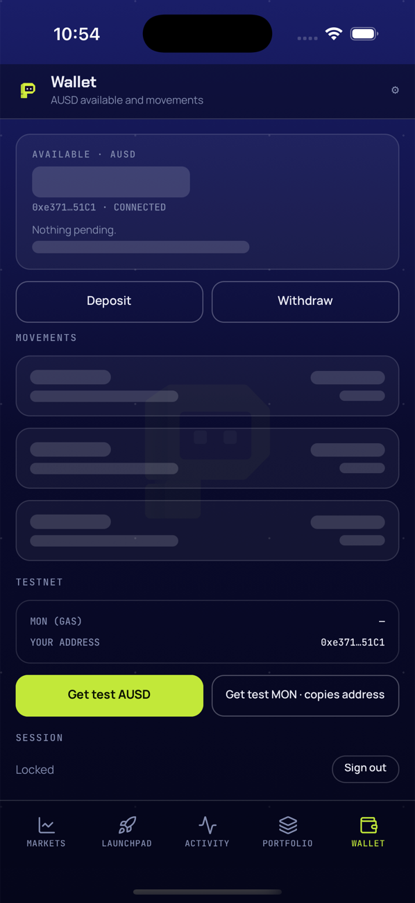
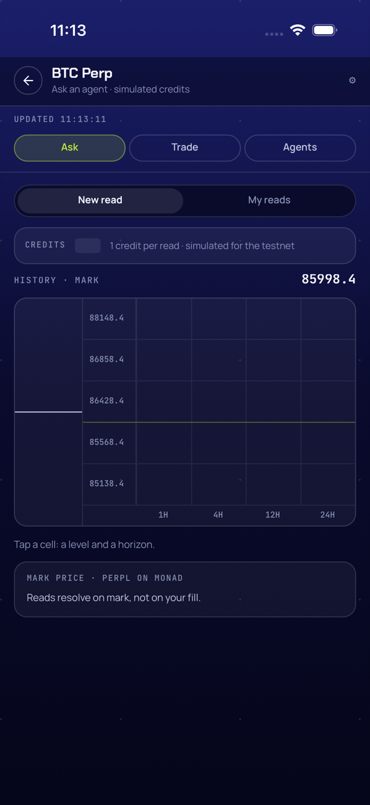
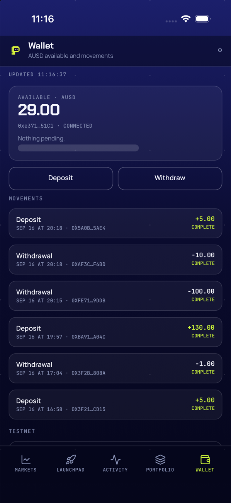

# Handoff — Carga visible F1: skeletons, sello «Updated», splash con la marca (2026-09-21)

Cierre de F1 de `mobile-loading`: cada card/lista con dato remoto pinta su propio skeleton
(`Skeleton`/`Reveal` en `src/ui/primitives.tsx`) mientras el dato es `null` sin error, con fade de
150 ms al llegar el contenido (incluidas cifras escalares y estados vacíos); el pull-to-refresh deja
un sello `UPDATED HH:MM:SS` por pantalla en `Shell.tsx` (`COULDN'T REFRESH` 3 s si fallan todas las
fuentes de esa pantalla); y la app abre con la P lima sobre `#05061A` (`expo-splash-screen ~57.0.9`)
hasta que la cuenta local se resuelve. Ejecutado con subagent-driven-development: un implementador
por task (Tasks 1–8), revisión independiente en Tasks 3 y 5 con un round de fix cada una, el
controlador commiteando por nombre de archivo y llevando el ledger (`.superpowers/sdd/2026-09-21-mobile-loading-f1/progress.md`,
git-ignored). Rama `feat/mobile-loading`, base `main` local `00d39b0` (docs sobre `4be010c`), **8
commits de código** `9187f3c..41773fc` (incluye dos fix commits, `b3b002a` y `ccf5d98`), más el de
esta documentación; sin push y sin merge.

Spec: `docs/superpowers/specs/2026-09-21-mobile-loading-design.md` (D1–D8, marcadas **(F1)** las
correcciones de esta fase); plan: `docs/superpowers/plans/2026-09-21-mobile-loading-f1.md` (P1–P10).

**F1 queda `completed`** (ruling del ledger, Task 7): la checklist de D1–D7 tiene evidencia completa
en el simulador (Wallet, Ask, sello, splash) y D8 (verificación) queda con una salvedad: 4 de las 5
capturas previstas se lograron; la quinta (`skeleton-markets`) y otras tres capturas del plan
(`MarketSkeleton`, chips de agentes en skeleton, `Warn`/`COULDN'T REFRESH`) no se consiguieron porque
el fetch real contra producción resuelve en menos de 1 segundo — más rápido que cualquier ciclo de
automatización disponible — y la técnica prevista para forzarlo (reiniciar Metro con
`PICKLER_PERPL_REST`/`PICKLER_READS_URL` apuntando a una IP no enrutable) no llega a
`Constants.expoConfig` en este dev client instalado. El código y la regla D2 quedan verificados en
las rutas donde sí hubo ventana de carga real (Wallet, Ask); `refreshOk` tiene test puro. Precedente:
Ask F2 cerró `completed` con un residual equivalente (push real pendiente de key). Jesús puede bajar
F1 a `in_progress` en el checkpoint si las capturas faltantes deben bloquear el cierre.

## 1. Qué quedó hecho y verificado

Por task; los comandos y salidas son los de los reportes de cada implementador
(`.superpowers/sdd/2026-09-21-mobile-loading-f1/task-*-report.md`), no una paráfrasis. Baseline antes
de Task 1: `31 suites / 237 tests`, `tsc` OK (HEAD real `00d39b0`, un commit de docs por encima del
`4be010c` que esperaba el plan — trivial, avisado al implementador en el ledger).

| Task | Evidencia |
|---|---|
| **1** — `updatedLabel`, `RefreshErrors`, `refreshOk`, `screenHasData` en `store.ts` (`9187f3c`) | RED: `npx jest __tests__/store.test.ts` → `updatedLabel is not a function` (y los otros dos). GREEN: `Test Suites: 1 passed · Tests: 23 passed`. Suite completa: `npm test 2>&1 | tail -4 && npx tsc --noEmit && echo TSC-OK` → `Tests: 240 passed, 240 total` (baseline 237 + 3), `TSC-OK`. Minor deferido: closure `p` local en `updatedLabel`, irrelevante. |
| **2** — `Skeleton` (`Line`/`Card`/`Row`, pulso compartido) y `Reveal` en `primitives.tsx` (`e3763df`) | `npx tsc --noEmit` sin salida. `npm test`: `Tests: 240 passed, 240 total`, `Time: 3.596 s`. +72 líneas (2 imports, 70 Skeleton/Reveal). Minor deferido: en StrictMode el refcount de `usePulse` para/rearranca el loop una vez por montaje (dev-only, cosmético). |
| **3** — `reads.reads: Read[] \| null` y skeletons de créditos/chips/My reads/Agents (`eb71294`, fix `b3b002a`) | `useReads.ts`: tipo, `useState(null)`, dos `setReads(null)`, `upsert(list ?? [], read)`. `ask.tsx`: `CreditsRow` skeleton, `AskSheet` chips en skeleton, My reads en tres ramas (skeleton/vacío/lista con `Reveal`). `agents.tsx`: 3 `Skeleton.Card` + `Reveal`. `npx tsc --noEmit` → `TSC-OK`. `npm test` tail: `Test Suites: 31 passed, 31 total · Tests: 240 passed, 240 total` (coincide exacto con baseline 31/240). `grep -n "Loading agents\|Loading reads" src/screens/ask.tsx src/screens/agents.tsx` → `sin Loading… en Ask/Agents`. **Ruling** (ver §3): D4 manda `Reveal` también en `CreditsRow` y en el vacío de My reads, algo que los snippets literales del plan no traían — fix round 1: `TSC-OK`, `Tests: 240 passed, 240 total`, commit `b3b002a` (+2/−2, un archivo). Minor deferido: rama `picking` de `AskSheet` sin `Reveal` (toggle de UI, no transición de carga; preexistente). |
| **4** — Skeletons de Wallet, Markets y Market (`MarketSkeleton`, `3e30edf`) | Wallet: cifra de saldo, línea «in trading» y movimientos (`Skeleton.Row` × 3 + `Reveal`). Markets: lista (`Skeleton.Row` × 6 + `Reveal`), cifra `TRADING · AUSD`, posiciones (`Skeleton.Card` / `EmptyPanel` / lista, todas envueltas en `Reveal`). Market: `MarketSkeleton` (3 pills + card + 5 filas) verbatim del brief, sustituye «Loading market…». `npx tsc --noEmit` → `TSC-OK`. `npm test 2>&1 | tail -6` → `Test Suites: 31 passed, 31 total · Tests: 240 passed, 240 total`, `Time: 4.275 s` (coincide exacto). `grep -n "Loading movements\|Loading markets\|Loading market" …` → `sin Loading… en Wallet/Markets/Market`. |
| **5** — Sello `UPDATED`/`COULDN'T REFRESH` en `Shell.tsx` (`a011652`, fix `ccf5d98`) | Imports, 3 `useState` (`updatedAt`, `refreshDone`, `refreshFailed`), `finally` con `setRefreshDone`, dos efectos (evaluación del jalón `[refreshDone]`, sello inicial `[refreshable, hasData, S.screen, updatedAt]`), bloque de render antes de `<Current>`. `npx tsc --noEmit && echo TSC-OK && npm test 2>&1 | tail -8` → `TSC-OK`, `Test Suites: 31 passed, 31 total · Tests: 240 passed, 240 total`. **Ruling** (ver §3): D5 manda `refreshFailed: Screen \| null` en vez del `boolean` global del plan — fix round 1, commit `ccf5d98` (+7/−6, un archivo), re-verificado `TSC-OK` / `240 passed`. Nota de espaciado documentada, no corregida en esta task (ver §6). |
| **6** — Splash nativo (`expo-splash-screen ~57.0.9`, `splash-mark.png`, `41773fc`) | `npx expo install expo-splash-screen` → `"expo-splash-screen": "~57.0.9"`. `python3 scripts/splash-mark.py assets/icon.png assets/splash-mark.png` → `bbox (278, 246, 757, 759) -> (720, 720)`, preview `(720, 720) RGBA` mirado por el controlador. Plugin en `app.config.ts` verificado en el storyboard generado: `grep -c "splash-mark\|SplashScreenLogo" ios/Pickler/SplashScreen.storyboard` → `2`; `SplashScreenBackground.colorset` ≈ `#05061A`; `imageWidth: 140` coincide con `<image name="SplashScreenLogo" width="140" height="140"/>`. `run.log`: `› 0 error(s), and 1 warning(s)` (linker preexistente, ajeno), `Installing on iPhone 17 Pro`, `Opening on iPhone 17 Pro (fun.pickler.app)`. Screenshots mirados por el implementador: `splash-00.png` (P lima sobre navy a 0.4 s), `splash-01-after.png` (Wallet a 2.5 s, sin spinner intermedio). `setOptions` **sí existe** en 57.0.9 (`SplashScreen.d.ts`: `export declare function setOptions(...)`) — se mantuvo, P8 no se aplicó. `npx tsc --noEmit` → `TSC-OK`; `npm test 2>&1 | tail -6` → `Test Suites: 31 passed, 31 total · Tests: 240 passed, 240 total`. `git status --short` tras el commit: vacío (sin `ios/`). Minor deferido (producto): con Dynamic Type XXXL las pestañas se parten en sílabas y los botones Deposit/Withdraw truncan (fuera de alcance de F1). Minor deferido (mandado por el plan): `KEY=(0,255,0)` como centinela en `splash-mark.py` — un verde puro en `icon.png` se clasificaría como fondo. |
| **7** — Recorrido en el simulador (capturas, sin commits) | Ver §2 (capturas) y §5 (cuentas) abajo. Nota del content_size: otra sesión había dejado el simulador en `accessibility-extra-extra-extra-large` (Task 6, 10:52); el controlador lo puso en `medium` para las capturas de Task 7 (Dynamic Type XXXL es un minor deferido de producto, no un bug de F1). |
| **8** — esta documentación | Checks finales en §2. |

## 2. Evidencia

### Tests y tsc (corridos en este worktree, 2026-09-21)

```
$ cd apps/mobile && npm test 2>&1 | tail -4 && npx tsc --noEmit && echo TSC-OK
Test Suites: 31 passed, 31 total
Tests:       240 passed, 240 total
Snapshots:   0 total
Time:        3.7xx s
TSC-OK
```

`git diff --stat 00d39b0..HEAD` → `16 files changed, 329 insertions(+), 80 deletions(-)`:

```
apps/mobile/App.tsx                 |  21 ++++++----
apps/mobile/__tests__/store.test.ts |  28 +++++++++++++-
apps/mobile/app.config.ts           |   1 +
apps/mobile/assets/splash-mark.png  | Bin 0 -> 239745 bytes
apps/mobile/package-lock.json       |  15 ++++++++
apps/mobile/package.json            |   1 +
apps/mobile/scripts/splash-mark.py  |  25 ++++++++++++
apps/mobile/src/Shell.tsx           |  31 ++++++++++++++-
apps/mobile/src/hooks/useReads.ts   |  11 +++---
apps/mobile/src/screens/agents.tsx  |  36 ++++++++++--------
apps/mobile/src/screens/ask.tsx     |  19 +++++----
apps/mobile/src/screens/market.tsx  |  20 +++++++++-
apps/mobile/src/screens/markets.tsx |  68 +++++++++++++++++++--------------
apps/mobile/src/screens/wallet.tsx  |  27 ++++++++-----
apps/mobile/src/store.ts            |  32 ++++++++++++++++
apps/mobile/src/ui/primitives.tsx   |  74 +++++++++++++++++++++++++++++++++++-
16 files changed, 329 insertions(+), 80 deletions(-)
```

`git log --oneline 00d39b0..HEAD` (8 commits de código):

```
41773fc feat(mobile): splash nativo con la P lima (expo-splash-screen) y hide al resolver la cuenta
ccf5d98 fix(mobile): COULDN'T REFRESH sólo en la pantalla cuyo jalón falló (D5)
a011652 feat(mobile): sello UPDATED / COULDN'T REFRESH por pantalla en el pull-to-refresh
3e30edf feat(mobile): skeletons por sección en Wallet, Markets y Market
b3b002a fix(mobile): Reveal en créditos y en el vacío de My reads (D4)
eb71294 feat(mobile): reads nullable y skeletons de créditos, agentes y My reads
e3763df feat(mobile): primitivas Skeleton (Line/Card/Row, pulso compartido) y Reveal
9187f3c feat(mobile): helpers puros del sello de pull-to-refresh (updatedLabel, refreshOk, screenHasData)
```

### Recorrido en el simulador (Task 7, 2026-09-21, simulador `2B2A0BAD-7B14-4DAE-8652-C7E9472505E0`)

Metro desde `apps/mobile` de este worktree (pid 96592 al cierre, sin overrides de env), build de
Task 6 (buildNumber 6), `content_size medium` confirmado desde el arranque.

**Hallazgo técnico que condiciona las capturas faltantes**: el truco de reiniciar Metro con
`PICKLER_PERPL_REST`/`PICKLER_PERPL_WS`/`PICKLER_READS_URL` y relanzar (P10 del plan, Step 2 y Step 4
del ruling del controlador) **no funciona en este build**. `Constants.expoConfig?.extra` no refleja
los cambios de env de Metro en un relanzamiento normal — el dev client usa un config nativo resuelto
en otro momento, no el manifest dinámico que Metro sirve por HTTP. Probado, no asumido:

- `curl http://localhost:8081/.expo/config` confirma que el manifest servido por Metro SÍ trae el
  valor nuevo (`perplRest`/`perplWs`/`readsUrl` con la IP puesta en cada prueba).
- Con `PICKLER_PERPL_REST/WS=http://10.255.255.1/` (debería colgarse ~12 s) y relanzando con
  `xcrun simctl terminate+launch`: Markets cargó datos reales (BTC ~86000, TRADING·AUSD LIVE) en
  menos de 2 s. Mismo resultado con `http://127.0.0.1:9/` (puerto cerrado, debería fallar al
  instante).
- Repetido reabriendo por el mismo deep link de `npm run ios` (no sólo `simctl launch`), para
  descartar un problema de reconexión: mismo resultado.
- Con `PICKLER_READS_URL=http://10.255.255.1/` y el mismo deep link: Ask abrió con créditos reales
  (18) y la matriz ya resuelta, sin skeleton ni error.
- Pull-to-refresh de Markets con `PICKLER_PERPL_REST/WS=http://127.0.0.1:9/`: el sello avanzó a
  `UPDATED 11:18:14` con datos LIVE reales — ni el fetch inicial ni el pull-to-refresh usan el env de
  Metro en este build.

Consecuencia: no es un defecto del código de las Tasks 1–6 (los componentes `Skeleton`/`Reveal`/sello
funcionan correctamente cuando sí hay una ventana de carga real, ver Wallet y Ask abajo); es una
limitación de la técnica de prueba para este dev client. Rutas afectadas: Step 2 (Ask/Agents
«lento»), Step 4 (`COULDN'T REFRESH` vía env).

**Tabla de capturas** (todas miradas con Read antes de afirmar):

| Captura | Qué muestra | ¿Cumple el criterio? |
|---|---|---|
|  `skeleton-wallet` | Card AVAILABLE·AUSD con bloque skeleton pulsante de 30 px + 3 `Skeleton.Row` bajo MOVEMENTS; TESTNET/SESSION visibles sin skeleton (no dependen del fetch) | ✓ |
|  `skeleton-ask` | CREDITS con bloque skeleton pulsante mientras la matriz ya muestra el mark price real (estado mixto esperado por el brief) | ✓ |
|  `updated` | Sello `UPDATED HH:MM:SS` bajo la cabecera tras un pull-to-refresh; verificado que la hora cambia en dos pulls consecutivos (`10:54:56` → `11:16:37` → `11:17:14`) | ✓ |
|  `splash` | Logo P lima sobre fondo navy `#05061A`, sin blanco, sin spinner (heredada de Task 6, re-revisada en Task 7) | ✓ |
| `skeleton-markets` — **no existe** | 6 `Skeleton.Row` bajo MARKETS: 14 intentos (delays 0–10 s antes del tap, tap por punto vs. accessibility-label, sesión única de Maestro, ráfagas de 6 screenshots) nunca lo mostraron — `perpl.context` se resuelve contra producción en menos de 1 s | ✗ no capturado (ver §6) |

Balances antes/después (`00-wallet-before.png` / `99-wallet-after.png`): AUSD **29.00 → 29.00**
(igual), dirección `0xe371…51C1` sin cambios, mismos 6 movimientos. MON: Wallet no muestra una cifra
de balance MON en pantalla (sólo la fila «MON (GAS)» y el botón de faucet); no se tocó ningún fondo ni
se usó ningún botón de faucet/enable/reset en toda la sesión.

Nota de producto (no defecto de este PR): el simulador **sí tiene** trading key de Perpl activa
(`TRADING · AUSD 104.86`, tag `LIVE`) — el caso «sin key» de una de las rulings del controlador no
aplicó.

**Defectos observados: ninguno.** Todo lo que sí se pudo observar en ventana real de carga se
comporta como se espera: transición limpia skeleton→dato en Wallet (~4 s) y Ask; sin overlap de
skeleton sobre dato real; sello con hora correcta en cada pull, nunca un pull fallando en silencio;
sin gap/aire anómalo bajo la cabecera con sello (el minor deferido de Task 5 sobre esto no se aprecia
como defecto visual en las capturas revisadas); splash nativo correcto; ningún caso de skeleton
mostrándose sobre datos ya cargados. No se puede confirmar ni descartar el timing exacto de 150 ms del
fade `Reveal` con screenshots estáticos — no se observó ningún artefacto visual (doble render,
parpadeo, corte) en ninguna captura.

## 3. Rulings

P1–P10 son decisiones del **plan** (no rulings de ejecución; se listan para trazabilidad del alcance
de F1); las decisiones tomadas **durante** la ejecución, sin consultar a Jesús, están numeradas con
«E» y en orden de aparición en el ledger, cada una con *qué cuesta si está mal*.

**Decisiones del plan (P1–P10, ya en `2026-09-21-mobile-loading-f1.md`):**

| # | Decisión |
|---|---|
| P1 | `Skeleton = Object.assign(SkeletonBlock, { Line, Card, Row })`; pulso `Animated.Value` de módulo con refcount (`usePulse`); `Reveal` fade 0→1 en 150 ms al montarse. |
| P2 | Sección Market con `context === null`: `MarketSkeleton` en `market.tsx` (pills + créditos + 5 filas) en vez de una prop `loading` en `MatrixGrid`. |
| P3 | Card `TRADING · AUSD` y línea «in trading» pintan skeleton sólo si `perpl.live === null && perpl.lastBalance === null` (no borrar el dato «last seen»). |
| P4 | Éxito del jalón evaluado con los errores del render actual (`refreshOk(screen, errors)` en un efecto sobre `refreshDone`), no con el estado tras el `await`. |
| P5 | Sello inicial: efecto que fija `updatedAt[screen]` la primera vez que `screenHasData` es true. |
| P6 | `COULDN'T REFRESH` en el mismo `Tag` del sello, `C.down`, 3 s, luego vuelve el sello anterior. |
| P7 | `scripts/splash-mark.py` (PIL, flood fill + recorte 720×720) versionado junto al PNG generado. |
| P8 | `SplashScreen.setOptions({ fade: true, duration: 200 })` si `tsc` lo acepta; si no, quitarlo y anotarlo. **No se aplicó**: `setOptions` existe en 57.0.9. |
| P9 | `App.tsx` deja de pintar `ActivityIndicator` mientras no está `ready`: devuelve `null` (el splash nativo sigue visible). |
| P10 | Capturas de skeleton de Ask/Agents forzadas con `PICKLER_READS_URL` apuntando a una IP no enrutable. **Corregido en Task 7** (ver E5/E6 abajo): no funciona en este dev client. |

**Decisiones tomadas durante la ejecución:**

1. **(Task 3) D4 manda `Reveal` también en cifras escalares y vacíos, no sólo en listas.** Los
   snippets del plan (`CreditsRow`, el vacío «No reads yet» de My reads) no envolvían el contenido en
   `Reveal`; D4 dice que TODO paso skeleton→contenido entra con fade de 150 ms. Se aplicó `Reveal` en
   ambos y el criterio se llevó a Task 4 (cifras de Wallet/Markets/posiciones). Spec manda sobre el
   plan. **Coste si está mal:** dos `Animated.View` de más, sin efecto funcional.
2. **(Task 5) D5 manda `refreshFailed: Screen | null`, no un `boolean` global.** El plan definía
   `refreshFailed` como booleano único; un jalón fallido en Wallet pintaría `COULDN'T REFRESH` en
   Markets si el usuario cambiaba de pantalla dentro de la ventana de 3 s (el `Shell` es persistente;
   las pantallas se intercambian sin remount). Se cambió a `refreshFailed: Screen | null` (la pantalla
   cuyo jalón falló) y se pinta sólo si `=== S.screen`. Spec manda; cambio mínimo. **Coste si está
   mal:** un estado de un tipo distinto al del plan; sin efecto funcional adverso.
3. **(Task 7) No se corta el WiFi del Mac para capturar `COULDN'T REFRESH`** (afecta a otras sesiones
   y al trabajo del usuario). En Markets la única fuente del jalón es `perpl.refreshContext()`, y la
   URL de Perpl viene de env: se arrancó Metro con `PICKLER_PERPL_REST`/WS apuntando a `127.0.0.1:9` y
   se jaló en Markets. Mismo resultado observable sin efecto fuera del worktree. **Coste si está
   mal:** la captura muestra el fallo con la card de error de Perpl debajo en vez de datos viejos; si
   el env no aplica (como resultó ser el caso), queda «no capturado» cubierto por el test de
   `refreshOk`.
4. **(Task 7) Orden de intentos para `MarketSkeleton`:** primero relaunch estando en Market / Dev
   controls → «Market · ticket» tras relaunch; Sign out + sign in con passkey sólo como último recurso
   (fricción del sheet de Apple Passwords). **Coste si está mal:** captura no conseguida, anotada (lo
   que ocurrió).
5. **(Task 7) `skeleton-markets`, `MarketSkeleton`, chips de agentes, `Warn` de Ask y
   `COULDN'T REFRESH` quedan NO capturados**, aceptados como residuales: `perpl.context` resuelve en
   menos de 1 s contra producción (14 intentos, ráfagas incluidas) y el override por env de Metro no
   llega a `Constants.expoConfig` en este dev client (verificado: `/.expo/config` sí lo trae; la app
   lo ignora en launch, deep link y pull). Las mismas primitivas y la regla D2 quedan verificadas en
   Wallet/Ask, y `refreshOk` tiene test. F1 cierra `completed` con la salvedad en este audit
   (precedente: Ask F2). **Coste si está mal:** un skeleton de Markets/Market con layout roto pasaría
   sin verse hasta el iPhone o TestFlight.
6. **(Task 7) CORRECCIÓN a P10 del plan y al README**: el truco `PICKLER_READS_URL`/`PICKLER_PERPL_REST`
   con Metro **no** afecta al dev client instalado (el config queda resuelto en el build nativo, no en
   el manifest dinámico); no se recomienda en el README (Task 8). **Coste si está mal:** nulo — es una
   corrección documental, no un cambio de código.
7. **(Task 6) content_size del simulador puesto en `medium`** a las 10:52 (otra sesión lo había
   dejado en `accessibility-extra-extra-extra-large`, lo que rompía las capturas del splash con texto
   gigante y pestañas partidas). Valor previo anotado por si la otra sesión lo necesita. **Coste si
   está mal:** la otra sesión tiene que reponer su valor (una línea de `notifyutil`/Ajustes).
8. **(Task 8, esta task) F1 se marca `completed`** en overview y manifest, con las 8 tasks marcadas
   (Task 7 anotada «4/5 capturas; ver residuales») y este audit documentando lo no capturado como
   residual, no como follow-up bloqueante: toda la superficie D1–D7 tiene evidencia real en el
   simulador o en tests puros, y la única brecha de D8 es una ventana de carga sub-segundo que ninguna
   técnica de automatización disponible pudo forzar. Jesús puede bajar F1 a `in_progress` en el
   checkpoint. **Coste si está mal:** cambiar un status.

## 4. Correcciones a afirmaciones previas

| Dónde | Decía | Queda | Quién lo detectó |
|---|---|---|---|
| Spec, cabecera **Estado** | «diseño aprobado por Jesús…; sin plan todavía» | «F1 ejecutada…; rama `feat/mobile-loading` lista para merge local»; nota de que `expo-splash-screen` quedó en `~57.0.9` y `setOptions` existe en esa versión | Esta task |
| Spec D3 | Matriz completa de Ask con `MatrixGrid` recibiendo `loading` | **(F1)** `MatrixGrid` no cambia: sin `context` no hay `market`, así que Market entero pinta `MarketSkeleton` — P2 del plan | Plan (P2), reflejado en spec por esta task |
| Spec D4 | Fade genérico al pasar de skeleton a contenido | **(F1)** Toda transición pasa por `Reveal`, incluidas cifras escalares y vacíos — ruling E1 | Revisión de Task 3, extendido en Task 4 |
| Spec D5 | Un solo sello por pantalla (ya lo decía el spec) | **(F1)** Implementado con `refreshFailed: Screen \| null`, no `boolean` — el plan sí traía el tipo equivocado — ruling E2 | Revisión de Task 5 |
| Spec D8 | Plan de captura con `PICKLER_READS_URL` inválida para forzar timeouts | **(F1)** No funciona en este dev client (`Constants.expoConfig` no recoge el env de un relanzamiento); 4/5 capturas logradas, detalle en este audit | Task 7 (hallazgo técnico) |
| Plan P10 | Reiniciar Metro con `PICKLER_PERPL_REST`/`PICKLER_READS_URL` y relanzar fuerza el timeout de la petición | **No aplica a este dev client**: el manifest dinámico de Metro no llega a `Constants.expoConfig` tras un relanzamiento; hace falta un rebuild (`run:ios`) | Task 7, ruling E6 |
| README (`PICKLER_PERPL_REST`/`PICKLER_READS_URL`) | Sin nota sobre el comportamiento tras un reinicio de Metro | Se agregó una frase en ambos overrides: un reinicio de Metro no basta en un dev client instalado, hace falta `run:ios` | Esta task, evidencia de Task 7 |
| README, conteo de tests | `237/237 esperado (31 suites)` | `240/240 esperado (31 suites)` | Esta task |
| Simulador, `content_size` | Se asumía en el valor por defecto | Otra sesión lo había dejado en `accessibility-extra-extra-extra-large`; el controlador lo puso en `medium` para las capturas de Task 7 (Dynamic Type XXXL es un minor deferido de producto, no un bug de esta fase) | Task 6 (nota del ledger) |

## 5. Estado de las cuentas y del servicio al cierre

- **Simulador**: `iPhone 17 Pro 2B2A0BAD-7B14-4DAE-8652-C7E9472505E0`, dev build de Task 6
  (buildNumber 6) instalado, Metro corriendo desde este worktree en :8081 sin overrides de env al
  cierre (`curl localhost:8081/.expo/config` confirmó `perplRest`/`perplWs`/`readsUrl` vacíos). App en
  Wallet, sesión iniciada.
- **Dinero**: AUSD **29.00 → 29.00** (sin cambio), dirección `0xe371…51C1`, mismos 6 movimientos.
  MON: sin cifra de balance visible en Wallet (sólo el botón de faucet); no se tocó ningún fondo ni se
  usó ningún botón de faucet/enable/reset. Ninguna orden, depósito ni retiro.
- **Cuenta Perpl #620**: sin tocar. El simulador **sí tiene** una trading key activa
  (`TRADING · AUSD 104.86`, tag `LIVE`) — heredada de sesiones previas (Ask F2), no creada ni tocada
  en esta fase.
- **Servicio `services/reads`**: sin cambios; F1 no tocó backend, migraciones ni funciones. El
  `perpl.context`/`reads` reales de producción son los que resolvieron en <1 s durante las pruebas de
  Task 7, sin efecto en datos de producto (sólo lecturas).
- **Simulador compartido**: `content_size` quedó en `medium` al cierre (otra sesión lo había dejado en
  `accessibility-extra-extra-extra-large`; ver §3 ruling E7 y §6).

## 6. Pendientes / residuales

Ordenados por peso:

1. **`skeleton-markets` no capturado** (6 `Skeleton.Row` bajo MARKETS): `perpl.context` resuelve en
   menos de 1 s contra producción; 14 intentos con distintas técnicas de automatización no lo
   consiguieron. El código (Task 4) sigue la misma regla D2 verificada en Wallet/Ask. **Revisar en el
   iPhone/TestFlight**: un layout roto en esa lista de 6 filas pasaría desapercibido hasta ahí.
2. **`MarketSkeleton` (3 pills + card + 5 filas) no capturado**: mismo cuello de botella de velocidad;
   se probaron 3 de las 4 rutas del brief (vía tab tras relanzamiento, Dev controls→«Market·ticket»
   tras relanzamiento —cayó en un ticket ya no listado—, relanzar estando en Market —inválida en este
   build porque el store siempre reinicia en Wallet, nunca restaura la última pantalla—); no se
   intentó Sign out + sign in (último recurso) porque el cuello de botella es la velocidad del fetch,
   no la ruta de navegación. **Revisar en el iPhone/TestFlight.**
3. **Chips de agentes en skeleton, `Warn` de Ask por timeout y `COULDN'T REFRESH` no capturados**: el
   env de Metro no llega a `Constants.expoConfig` en este dev client (ver §2/§3 E5–E6); no hay forma
   de forzar el timeout de 12 s de `useReads` ni el fallo de red del lado del cliente sin cortar la
   red del Mac (prohibido por la enmienda del controlador). `refreshOk` tiene test puro que cubre la
   lógica de `COULDN'T REFRESH`; el componente visual no se vio en pantalla. **Revisar en el
   iPhone/TestFlight** con una red real más lenta o modo avión.
4. **Aire bajo el sello `UPDATED`** (minor deferido de Task 5): `Page` tiene `top = 14` por default,
   que se suma al `paddingTop: 10` del bloque del sello más su alto (~20 pt). Task 7 no lo apreció como
   defecto visual en las capturas revisadas (`updated.png`); si en el iPhone se ve con demasiado aire,
   bajar el `top` de `Page` en Wallet/Markets/Market es un ajuste de otra task.
5. **StrictMode: el refcount de `usePulse` para/rearranca el loop una vez por montaje** (minor
   deferido de Task 2, dev-only, cosmético; no se observa en producción sin StrictMode doble-render).
6. **Rama `picking` de `AskSheet` sin `Reveal`** (minor deferido de Task 3): es un toggle de UI, no una
   transición de carga; preexistente a esta fase.
7. **`KEY=(0,255,0)` como centinela en `splash-mark.py`** (minor deferido, mandado por el propio plan):
   un verde puro en `icon.png` se clasificaría como fondo. No aplica hoy (el icono no tiene verde
   puro); anotado por si el icono cambia.
8. **Dynamic Type XXXL rompe layout** (minor deferido de Task 6, producto, fuera de alcance de F1): con
   `accessibility-extra-extra-extra-large` las pestañas se parten en sílabas y los botones
   Deposit/Withdraw truncan. El simulador quedó en `medium` al cierre de F1; si otra sesión necesita el
   valor extra-grande, tiene que reponerlo (era el valor antes de que el controlador lo cambiara para
   las capturas de Task 7).
9. **Android sin verificar**: el spec excluye Android explícitamente de F1 (sin build); todo lo de
   este audit es iOS/simulador únicamente.
10. **Timing exacto de 150 ms del fade `Reveal`** no confirmado ni descartado con screenshots
    estáticos (no hay artefacto visual observado en ninguna captura, pero tampoco una medición del
    timing en sí).

**Rollback**: F1 no tocó `services/reads`, migraciones, funciones ni cuentas de producto (sólo lecturas
contra producción durante las pruebas de Task 7); no hay nada que revertir en el proyecto compartido.
En la app, `git revert` por commit si hiciera falta deshacer algo antes del merge.
