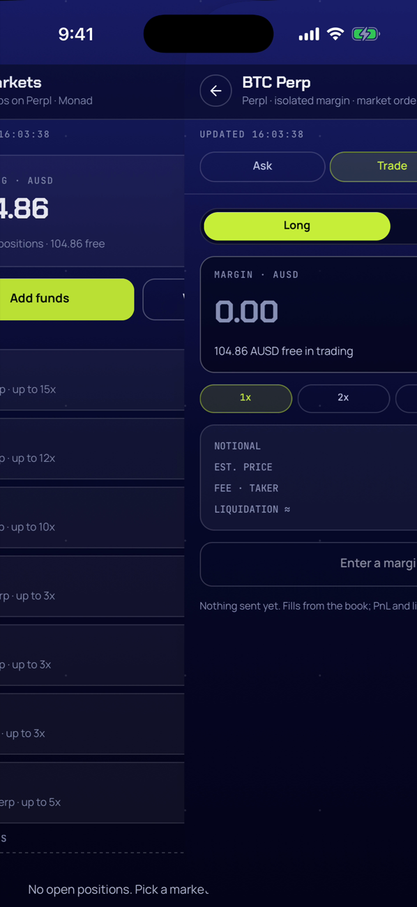
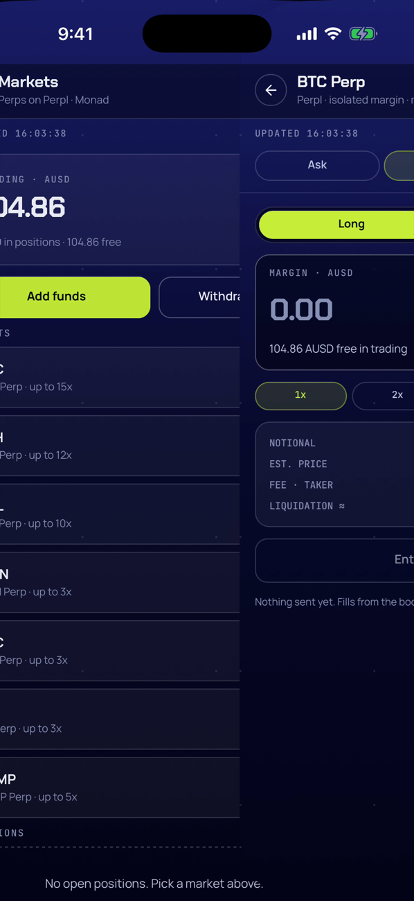
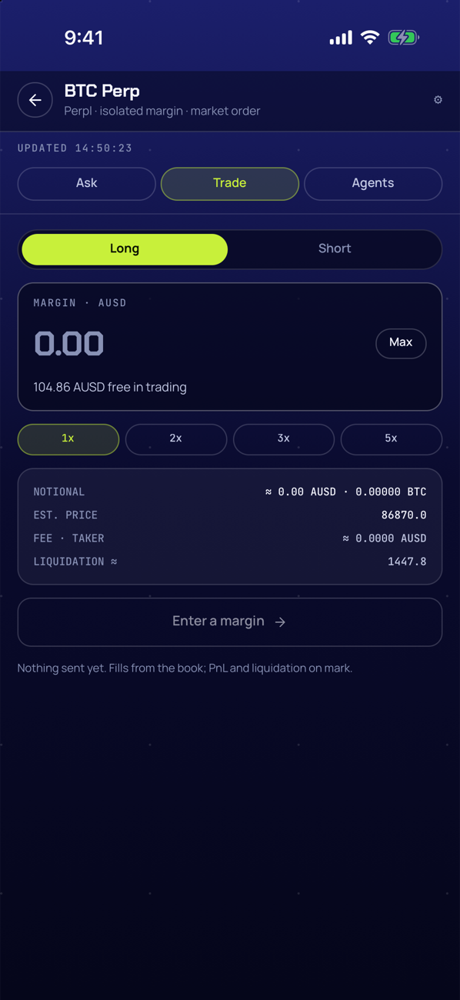
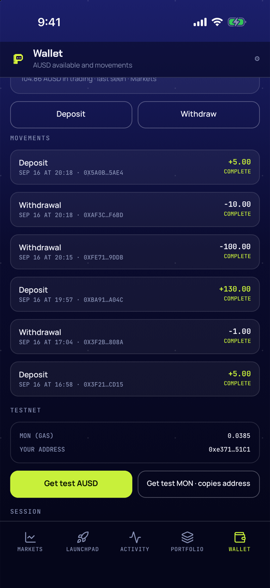

# Handoff — Navegación nativa (mobile-nav) F1: pilas por pestaña, gesto atrás iOS, `Page` y gate (2026-09-21)

Cierre de F1 de `mobile-nav`: la app migró de un store propio (`screen`+`stack`, `Shell` pintando
una sola pantalla, `PanResponder` para el swipe) a `react-navigation` nativo — `native-stack`
(sobre `react-native-screens`, es decir `UINavigationController`) dentro de `bottom-tabs`, con
**una pila por pestaña**. El gesto atrás, el «adelante» animado y el botón `←` son ahora los de
iOS sin código de animación propio; la cabecera viaja con la página (`Page`, `headerShown: false`
en los stacks); el store quedó sólo con datos; el gate de cuenta y el push a Market saltan de
pestaña y apilan sobre Markets (D10). Ejecutado con subagent-driven-development: un implementador
por task (Tasks 1–7), revisión independiente en Tasks 2, 3+4 y 6 con rondas de fix donde hizo
falta, el controlador commiteando por nombre de archivo y llevando el ledger
(`.superpowers/sdd/2026-09-21-mobile-nav-f1/progress.md`, git-ignored). Rama `feat/mobile-nav`,
base `main` local `6e9326c` (build 7 en TestFlight), **9 commits de código** `0931f78..824a2f2`
(`git log --oneline 0931f78..824a2f2` da 8 más el propio `0931f78` = 9; de ellos 3 llevan el
prefijo `fix(mobile):` — `68fb17b`, `5cb9d32`, `824a2f2`), más el commit de esta documentación;
sin push y sin merge.

Spec: `docs/superpowers/specs/2026-09-21-mobile-nav-design.md` (D1–D12; D11 es F2, marcadas
**(F1)** las decisiones donde la ejecución se apartó del texto original); plan:
`docs/superpowers/plans/2026-09-21-mobile-nav-f1.md` (P1–P10).

**F1 queda `completed`**: D1–D10 y D12 (sin F2) tienen evidencia completa en tests puros y en el
simulador (gesto a medio camino, adelante, `←`, push en frío, sign-in con `next`, sign out, tab
bar oculta en no-raíz, scroll conservado); las 5 capturas de D12 están en
`docs/superpowers/audits/img/`, dos de ellas (`gesture-mid`, `push-forward`) obtenidas por video +
extracción de frames porque el input sintético no dispara el reconocedor de gesto de borde de iOS
(residual: verificar el gesto real en el iPhone). `npm test` → 31 suites / 232 tests; `tsc` limpio.

## 1. Qué quedó hecho y verificado

Por task; los comandos y salidas son los de los reportes de cada implementador
(`.superpowers/sdd/2026-09-21-mobile-nav-f1/task-*-report.md`), no una paráfrasis.

| Task | Evidencia |
|---|---|
| **1** — Dependencias nativas (`react-native-screens`, `gesture-handler`, `reanimated`/`worklets`, `expo-haptics`, `@react-navigation/*`), `GestureHandlerRootView`, rebuild (`0931f78`) | Versiones (`grep` en `package.json`): `"@react-navigation/bottom-tabs": "^7.19.2"`, `"@react-navigation/native": "^7.4.1"`, `"@react-navigation/native-stack": "^7.19.2"`, `"expo-haptics": "~57.0.3"`, `"react-native-gesture-handler": "~2.32.0"`, `"react-native-reanimated": "4.5.1"`, `"react-native-screens": "~4.26.0"`, `"react-native-worklets": "0.10.1"` — todas coinciden con lo esperado. `grep -c "RNScreens\|RNGestureHandler\|RNReanimated\|RNWorklets" ios/Podfile.lock` → **33** ocurrencias, con `:path` a `node_modules` y checksum cada una. `run.log` tail: `› Build Succeeded`, `⚠️ ignoring duplicate libraries: '-lc++'`, `› 0 error(s), and 1 warning(s)`, `Installing on iPhone 17 Pro`, `Opening on iPhone 17 Pro (fun.pickler.app)` — sin ningún error de reanimated/worklets. `npx tsc --noEmit` → `TSC-OK`; `npm test` → `Test Suites: 31 passed, 31 total` / `Tests: 242 passed, 242 total` (antes y después de tocar `App.tsx`). Screenshot `t1-boot.png` mirado: app abrió directo en Wallet (AUSD 29.00, sello `UPDATED 14:08:38`, movimientos), mismo aspecto que build 7. `expo-doctor`: 2 fallos preexistentes (duplicado de `expo-constants`, drift de versión en `expo`/`expo-build-properties`/`@types/react`/`@types/jest`), ninguno relacionado con las 7 dependencias nuevas (confirmado con `git diff package.json`). |
| **2** — Tabla de rutas y gate puros (`routes.ts`, `14a4777`) | RED: `npx jest __tests__/routes.test.ts` → `Cannot find module '../src/navigation/routes' from '__tests__/routes.test.ts'`. GREEN: `PASS __tests__/routes.test.ts` — 3/3 (`every screen except signin belongs to exactly one tab…(D1)`, `screenOfRoute maps route names back to screens…`, `gateTarget sends gated screens to signin…(D5)`). Suite completa: `Test Suites: 32 passed, 32 total` / `Tests: 245 passed, 245 total`; `TSC-OK`. +78 líneas (`routes.ts` +49, `routes.test.ts` +29). |
| **3** — Adaptador sobre `navigationRef` (`ref.ts`, dentro de `f56d282`) | Implementado verbatim del brief; tipos de `routes.ts` (`RootParamList`, `TAB_OF`, `screenOfRoute`) verificados antes de escribir. **Cast de tipos: ninguno** — `navigationRef.navigate("Tabs", { screen: tab, params: { screen } } as never)` y `resetRoot({ index: 0, routes: [{ name: route }] })` compilaron a la primera. `npx tsc --noEmit` → sin salida (exit 0); `npm test` tail → `Test Suites: 32 passed, 32 total` / `Tests: 245 passed, 245 total`. |
| **4** — `useRefreshSeal`/`useCurrentScreen` (dentro de `f56d282`, fixes `68fb17b`/`5cb9d32`) | Implementado verbatim; `accountAddress(AccountState)` (`src/account.ts:9`) acepta `status: "none"` sin adaptación; `navigationRef.addListener("state", read)` tipó limpio en `@react-navigation/native` 7.4.1. `npx tsc --noEmit` → sin salida; `npm test` tail → 32/245. **Fix round 1** (revisión): Finding 1 — `markInitial` hacía `setState` síncrono durante el render de `Page`; Finding 2 — `onRefreshDone` leía `errorsRef.current`, stale tras el `finally` de un `await`. Cambios: `REFRESHABLE` movido a `store.ts`; `onRefreshDone` sólo incrementa un contador; nuevo efecto sobre `[done]` decide `refreshOk` con los errores del render vigente; sello inicial movido a un efecto sobre `has = REFRESHABLE.map(hasData)`; `labelFor` puro. `npx tsc --noEmit` limpio; `npm test` → 32/245. Commit `68fb17b` (+30/−22, 2 archivos). **Fix round 2**: el sello inicial no reaparecía al cambiar entre dos cuentas con saldo ya cargado (`has[0]` no cambiaba). Efecto de reset por cuenta declarado **antes** del efecto de sello inicial (orden de declaración = orden de ejecución) y `address` agregado a las deps del sello inicial. `npx tsc --noEmit` limpio; `npm test` → 32/245. Commit `5cb9d32` (+11/−6, 1 archivo). |
| **5** — `Page`, `TabBar`, `Navigator` compilan sin usarse (`95ebc0d`) | `Page.tsx`/`TabBar.tsx` importan `useAppCtx` de `../navigation/context` (PF1, no de `Navigator.tsx`); `REFRESHABLE` importado de `../store`, no redeclarado (R2); `withPage` tipado con `AppCtx` de `../ctx`. `STACK`: `headerShown: false, gestureEnabled: true, fullScreenGestureEnabled: false, animation: "default"`; tabs con `animation: "none"`. `npx tsc --noEmit` → `TSC-OK`; `npm test` tail → `Test Suites: 32 passed, 32 total` / `Tests: 245 passed, 245 total`, `Time: 3.715 s`. Smoke: `t5-smoke.png` mirado — la app sigue mostrando el `Shell` viejo (Wallet, sello `UPDATED 14:30:54`, saldo 29.00), porque nada monta todavía `Page`/`Navigator`; sin pantalla roja ni error de evaluación de módulo. |
| **6** — Conmutación: store sólo con datos, `App.tsx` con `Navigator`, adiós `Shell` (`16c9f3a`; fix v7 `824a2f2`) | TDD del store — RED: `Tests: 1 failed, 13 passed, 14 total` (`signedOutState clears the Ask state … expect(signedOutState(s)).toEqual({ ...INITIAL })` — diff mostraba `screen`/`next`/`nextPatch` de más). GREEN: `store.test.ts` + `routes.test.ts` → `Tests: 17 passed, 17 total`. Verde final: `npx tsc --noEmit` → `TSC-OK`; `npm test` → `Test Suites: 31 passed, 31 total` / `Tests: 232 passed, 232 total` (245 − 11 tests de store borrados − 2 de `gestures.test.ts` que el brief no restó + 0 netos = 232). `git rm src/Shell.tsx src/ui/gestures.ts __tests__/gestures.test.ts`. **Desviación 1** (ver §4): ciclo `store.ts ↔ navigation/ref.ts ↔ navigation/routes.ts ↔ store.ts` — Metro lo avisó en cada arranque con el texto exacto: `WARN Require cycle: src/store.ts -> src/navigation/ref.ts -> src/navigation/routes.ts -> src/store.ts` (y dos WARN más rotando el ciclo), y en el simulador un LogBox amarillo tapaba la tab bar. Fix: `Screen`, `GATED`, `CAN_BACK`, `SHOW_TABS`, `ROOT_OF` movidos a `src/navigation/screens.ts` (nuevo), re-exportados desde `store.ts`; `Patch` se queda en `store.ts` (`routes.ts` lo importa con `import type`, que Babel elimina del bundle). Tras el fix, relanzamiento limpio: sólo `iOS Bundled …`, sin WARN. Smoke con 4 capturas miradas (`t6-wallet.png`, `t6-markets.png`, `t6-market.png`, `t6-back.png`): Wallet → Markets (`TRADING · AUSD 104.86 LIVE`) → Market BTC (sin tab bar) → back a Markets con sello y scroll conservados. **Gesto de borde**: swipe sintético de Maestro y de idb HID no dispararon `UIScreenEdgePanGestureRecognizer`; con `fullScreenGestureEnabled: true` temporal, un swipe desde el centro sí completó el pop con transición nativa — confirma que la maquinaria de `react-native-screens` funciona y que es el reconocedor de borde el que rechaza input sintético que empieza en x≈0 (limitación conocida de XCTest/HID). Revertido antes del commit (`git diff` vacío). **Review inicial → Needs fixes**: C1 sign-in con `next` dejaba `signin` bajo un segundo `Tabs`; C2 `nav()` a una ruta ya en la pila la duplicaba; I1 (D10) Market se montaba sin Markets debajo — causa verificada por el revisor en `@react-navigation/routers` 7.6.4 (`StackRouter.tsx:385-395`): el plan (P3) asumía la semántica v6 de `navigate`. **Fix round 1 (Ruling R5, commit `824a2f2`)**: `ref.ts` → `navigateTo` usa `nested = screen === TAB_ROOT[tab] ? { screen, pop: true } : { screen, initial: false, pop: true }` y `navigationRef.navigate("Tabs", { screen: tab, params: nested } as never, { pop: true })`; nuevo `switchTab(tab)` = `navigate("Tabs", { screen: tab }, { pop: true })` sin params anidados; `AppStore.switchTab` con gate; `TabBar` llama `switchTab`, no `requireAccount`. Verificado con 5 flujos (a1, a2, b, c, c2, d) en el simulador, todos con captura mirada — tabla completa en §2. `npx tsc --noEmit` → `TSC-OK`; `npm test` → 31/232. |
| **7** — Recorrido en el simulador, capturas D12 (sin commits; addendum con `R6`) | Balances antes/después idénticos (§5). Tabla completa de capturas y las 5 finales en §2. `gesture-mid`/`push-forward` no se lograron con screenshots cronometrados tras >10 intentos cada uno (jitter de arranque de Maestro/idb de 100 ms–1 s+, mayor que la animación de ~300 ms) — resueltos con **Ruling R6**: `xcrun simctl io <UDID> recordVideo --codec h264` + `ffmpeg` para extraer frames, con `fullScreenGestureEnabled: true` temporal (revertido, `git checkout --`) para `gesture-mid`. Push en frío (`xcrun simctl push` con `push.apns`) aterrizó directo en Market · Ask · My reads (D10); `back` → Markets, no Wallet. Ningún defecto encontrado en todo lo que sí se pudo observar de punta a punta. Incidente operativo (no defecto de la app): un bucle de captura mal controlado disparó ~937 procesos `simctl` concurrentes y tumbó momentáneamente `IOSurfaceClient`; se mató el lote, el simulador siguió booteado, no volvió a ocurrir. |

## 2. Evidencia

### Tests, tsc y diffstat (corridos en este worktree, 2026-09-21, HEAD `824a2f2`)

```
$ cd apps/mobile && npm test 2>&1 | tail -6 && npx tsc --noEmit && echo TSC-OK
Test Suites: 31 passed, 31 total
Tests:       232 passed, 232 total
Snapshots:   0 total
Time:        3.715 s, estimated 4 s
Ran all test suites.
TSC-OK
```

```
$ git diff --stat 9839540..HEAD -- apps/mobile | tail -22
 apps/mobile/App.tsx                       |  61 ++--
 apps/mobile/__tests__/gestures.test.ts    |  17 -
 apps/mobile/__tests__/routes.test.ts      |  29 ++
 apps/mobile/__tests__/store.test.ts       | 104 +-----
 apps/mobile/package-lock.json             | 538 +++++++++++++++++++++++++++++-
 apps/mobile/package.json                  |   8 +
 apps/mobile/src/DevControls.tsx           |   6 +-
 apps/mobile/src/Shell.tsx                 | 176 ----------
 apps/mobile/src/ctx.ts                    |   3 +-
 apps/mobile/src/hooks/useCurrentScreen.ts |  14 +
 apps/mobile/src/hooks/useRefreshSeal.ts   |  65 ++++
 apps/mobile/src/navigation/Navigator.tsx  |  82 +++++
 apps/mobile/src/navigation/context.tsx    |  15 +
 apps/mobile/src/navigation/ref.ts         |  66 ++++
 apps/mobile/src/navigation/routes.ts      |  50 +++
 apps/mobile/src/navigation/screens.ts     |  19 ++
 apps/mobile/src/screens/signin.tsx        |   7 +-
 apps/mobile/src/store.ts                  | 148 +++-----
 apps/mobile/src/ui/Page.tsx               | 109 ++++++
 apps/mobile/src/ui/TabBar.tsx             |  46 +++
 apps/mobile/src/ui/gestures.ts            |  13 -
 21 files changed, 1133 insertions(+), 443 deletions(-)
```

21 archivos, +1133/−443 — coincide exactamente con lo medido por el controlador. `src/Shell.tsx` y
`src/ui/gestures.ts` se borran; `src/navigation/{screens,routes,ref,context,Navigator}.ts(x)` y
`src/ui/{Page,TabBar}.tsx` son nuevos (siete archivos, uno más de los seis que preveía el mapa de
archivos del plan — `screens.ts` es la desviación 1 de Task 6).

```
$ git log --oneline 0931f78..824a2f2
824a2f2 fix(mobile): navigate con pop/initial (semántica v7): sign-in con next saca signin, sin duplicados en las pilas, Market sobre Markets; switchTab para la tab bar
16c9f3a feat(mobile): navegación nativa con react-navigation — store sólo con datos, Navigator en App, Sign in con next por params; fuera Shell y gestos propios
95ebc0d feat(mobile): Page (cabecera + refresh + sello por ruta), TabBar y Navigator (RootStack → Tabs → pila por pestaña), sin conmutar
5cb9d32 fix(mobile): el sello inicial se re-evalúa tras el reset por cambio de cuenta (useRefreshSeal)
68fb17b fix(mobile): useRefreshSeal evalúa el jalón en un efecto (contador) y sella el inicial desde el hook, sin setState en render
f56d282 feat(mobile): useRefreshSeal (sello fuera del Shell) y useCurrentScreen (pantalla activa por ruta)
7dd8ba9 feat(mobile): adaptador de navegación sobre navigationRef (navigateTo, goBackIfCan, resetRootTo, cola hasta isReady)
14a4777 feat(mobile): tabla de rutas y gate puros para react-navigation (routes.ts)
```
8 commits en el rango (excluye `0931f78`, que los incluye a los 9 en total); 3 llevan el prefijo
`fix(mobile):`.

### Flujos v7 verificados en el simulador (fix round 1, Task 6)

| Caso | Pasos reales | Captura | Visto |
|---|---|---|---|
| a1 — `nav("markets")` desde pantalla apilada (C2) | Markets → `market-BTC` → ⚙ → chip «Markets» | `r5a-markets.png` | Markets **sin `←`**, tab bar visible → no queda `[markets, market, markets]`. |
| a2 — pila conservada al cambiar de pestaña | Market BTC → ⚙ → chip «Wallet» → `tab-markets` | `r5a-wallet.png`, `r5a-kept.png` | Wallet sin `←`; `tab-markets` vuelve a **Market BTC** con `←` (la pila `[markets, market]` se conservó). |
| b — `nav("wallet")` desde Deposit | `tab-wallet` → `deposit` → «I've sent it» | `r5b-deposit.png`, `r5b-wallet.png` | Wallet **sin `←`**, tab bar. |
| c — sign out / arranque sin cuenta / gate / sign-in con `next` | ⚙ → Sign out → Signin; relaunch; ⚙ → chip «Markets» (gate) → sign in (passkey «pickler», sheet + Face ID) | `r5c-signout.png`…`r5c-landed.png` | Sign out → Signin sin `←`; relaunch → Signin (ruta inicial) sin tarjeta; chip Markets → Signin **con tarjeta** «We kept what you were about to do · Trading on Perpl» pero sin `←` (raíz `[signin]`); tras firmar: **Markets sin `←`**, tab bar, TRADING 104.86 LIVE (misma cuenta). |
| c2 — gate con Tabs debajo (Signin con `←`, C1) | Sign out → ⚙ → «Launchpad» (no gated) → `tab-markets` (gate) → sign in | `r5c2-launchpad.png`…`r5c2-landed.png` | Launchpad con tab bar; Signin **con `←`** y tarjeta «Trading on Perpl»; tras firmar Markets sin `←` con tab bar (`signinIsRoot` → `resetRoot(Tabs)` + `nav("markets")`). |
| d — D10 con pila de Markets fresca (I1) | relaunch → Wallet → ⚙ → «Market · ticket» → `←` | `r5d-wallet.png`, `r5d-market.png`, `r5d-back.png` | Market en la pestaña Markets con `←`; `←` → **Markets** (no Wallet): `initial: false` dejó `markets` debajo. |

Log de Metro limpio en todos los relanzamientos (sólo `iOS Bundled`).

### Capturas de evidencia (D12)

| Captura | Qué muestra |
|---|---|
|  | BTC Perp desplazada a la derecha conservando su propia cabecera «← BTC Perp» y panel de margen, con Markets asomando por la izquierda con velo (título, subtítulo, balance, botón «Add funds», filas de mercados) — frame `g-006.png` extraído de `vid-gesture.mp4` (`ffmpeg`, ~6.4 s de una grabación de 8.25 s con `maestro swipe start "20%,50%" end "80%,50%" duration 300` y `fullScreenGestureEnabled: true` temporal). |
|  | Markets ocupa la mitad izquierda (título, balance, «Add funds», filas cortadas) mientras BTC Perp ya trae su propia cabecera «← BTC Perp», pills Ask/Trade, Long/Short y panel de margen en la mitad derecha — frame `f-012.png` de `vid-push.mp4` (grabación de 9.82 s, tap disparado por Maestro tras esperar `wait $TAPPID`). |
|  | Market (BTC Perp) con `←`, cabecera propia, pills Ask/Trade/Agents, ticket; sin tab bar inferior (D9). |
|  | Signin **con `←`** (Tabs debajo) y tarjeta «We kept what you were about to do · Trading on Perpl» (`heldActionFor(next)`), tras un gate desde Launchpad → `tab-markets`. |
|  | Wallet tras Deposit → back: sigue con TESTNET (Get test AUSD/MON) visible, tab bar presente — el `ScrollView` de `Page` no resetea la posición al volver. |

Las cinco están en `docs/superpowers/audits/img/`, reducidas con `sips -Z 1300`, verificadas con
`Read` antes de copiarlas. `ls docs/superpowers/audits/img/2026-09-21-mobile-nav-*.png` confirma
las 5 presentes en este worktree.

## 3. Rulings

**Decisiones del plan (P1–P10, ya en `2026-09-21-mobile-nav-f1.md`):**

| # | Decisión |
|---|---|
| P1 | Construir al lado y conmutar en Task 6: Tasks 2–5 crean módulos nuevos que compilan sin usarse; Task 6 cambia store/`App.tsx`, borra `Shell.tsx` y `ui/gestures.ts`. |
| P2 | `AppCtx` por React context (`AppCtxProvider`/`useAppCtx`); `withPage(screen, Component)` lee el contexto y renderiza `<Page screen><Component {...ctx} /></Page>`. |
| P3 | `navigate` a rutas anidadas hace el trabajo del gate de vuelta (vuelve a `Tabs` y aplica lo anidado); `finishSignin` sólo hace `resetRoot` cuando `signin` fue la ruta inicial. **Corregido por Ruling R5** (semántica v6 asumida, incorrecta en v7 — ver §4). |
| P4 | Pestaña con ruta no raíz → la tab bar custom devuelve `null` (no `tabBarStyle: display none`); `Page` pone la `SafeAreaView` inferior cuando la tab bar no está. Limitación conocida: la tab bar aparece al terminar la transición de vuelta a una raíz, sin animarse — residual (§6). |
| P5 | Pantalla activa: `useCurrentScreen()` escucha `navigationRef.addListener("state")`; vale `"wallet"` hasta que hay estado. `useAppStore` recibe `scr` como input. |
| P6 | `held` de Sign in = `heldActionFor(route.params?.next)`; `finishSignin` lee `next`/`patch` de los params del `signin` enfocado. |
| P7 | Cola de navegación hasta `isReady` en `ref.ts` (`pending`), vaciada en `onReady`. La cola de push por `account === null` de `App.tsx` se conserva tal cual. |
| P8 | `CAN_BACK` se mantiene como filtro del botón `←`. |
| P9 | Tests: `routes.test.ts` nuevo, `store.test.ts` recortado, `gestures.test.ts` borrado. |
| P10 | Rebuild en Task 1, no al final: instalar deps + `GestureHandlerRootView` + prebuild + `run:ios` con la app vieja, comprobar que arranca antes de escribir la migración. |

**Decisiones tomadas durante la ejecución (ledger):**

1. **Ruling PF1** (pre-flight) — `AppCtxProvider`/`useAppCtx` van en `src/navigation/context.tsx`
   (nuevo, sin imports de la app salvo el tipo `AppCtx`); `Page.tsx`, `TabBar.tsx` y `Navigator.tsx`
   importan de ahí. Rompe el ciclo `Page ↔ Navigator` del plan. **Coste si está mal:** un archivo
   más de 12 líneas.
2. **Ruling PF2** (pre-flight) — Tasks 3 y 4 se despachan en lote a un solo implementador (módulos
   pequeños, sin archivos compartidos, código completo en el plan) con una sola revisión del diff
   conjunto. **Coste si está mal:** una revisión algo más larga.
3. **Ruling R1** (Task 3+4, fix round 1) — `useRefreshSeal` pasa al patrón contador+efecto del
   `Shell` original: `onRefreshDone(screen)` sólo incrementa `done = { n, screen }`; un efecto sobre
   `done` evalúa `refreshOk(done.screen, errors)` con los errores de ESE render, sella o marca
   `failed = screen` y arma el timeout de 3 s con cleanup. **Coste si está mal** (junto con R2): un
   sello de Markets fechado antes de entrar a Markets (semántica igual o mejor que P5).
4. **Ruling R2** (Task 3+4, fix round 1) — `labelFor` es puro; el sello inicial lo pone un efecto
   del propio hook sobre `REFRESHABLE` (const movida a `store.ts`, que `Page` también usa) cuando
   `hasData(s)` pasa a `true` por primera vez — ya no hay `setState` en render. **Coste:** ver R1.
5. **Ruling R3** (Task 3+4, fix round 2) — el efecto del sello inicial añade `address` a sus deps y
   se declara **después** del efecto de reset (el orden de efectos es el orden de declaración): al
   cambiar de cuenta, el reset limpia y el efecto re-sella si hay dato (mismo comportamiento que el
   `Shell` original). **Coste si está mal:** un sello con la hora del cambio de cuenta sobre saldos
   de la cuenta anterior durante &lt;1 s (paridad con lo que había).
6. **Ruling R4** (Task 6, para Task 7) — el gesto desde el borde no se puede disparar
   sintéticamente (Maestro/idb); para la captura a medio camino se usa `fullScreenGestureEnabled:
   true` como cambio temporal NO commiteado (revertido antes del commit de Task 8) y se anota en
   el audit; la prueba real del borde queda para el iPhone. **Coste si está mal:** la captura
   muestra el mismo efecto visual con otro punto de inicio del gesto.
7. **Ruling R5** (Task 6, corrige P3 del plan) — en `ref.ts`, `navigateTo(screen)` para pantallas
   de pestaña usa `navigationRef.navigate("Tabs", { screen: tab, params: nested }, { pop: true })`
   con `nested = { screen, pop: true }` para raíces y `{ screen, initial: false, pop: true }` para
   no-raíces (así Market se apila sobre Markets aunque la pestaña se monte por primera vez — D10 —
   y volver a una ruta existente hace pop). Nuevo `switchTab(tab)` en `ref.ts` =
   `navigate("Tabs", { screen: tab })` sin params anidados (sólo enfoca, conserva la pila);
   `AppStore` gana `switchTab(tab: TabName)` con gate; `TabBar` llama `switchTab`, no
   `requireAccount`. El fixer verificó en `node_modules` la firma `navigate(name, params, { pop })`
   de v7 antes de escribir. **Coste si está mal:** media ronda más; sin alternativa (la semántica
   v7 está verificada en el fuente).
8. **Ruling R6** (Task 7) — un intento más con `xcrun simctl io <UDID> recordVideo` + swipe rápido
   (que sí hace pop con animación) y tap `market-BTC`, extrayendo frames con `ffmpeg`; si tampoco,
   quedan como residuales para el iPhone. **Coste si está mal:** ~10 min.

## 4. Correcciones a afirmaciones previas

| Dónde | Decía | Queda | Quién lo detectó |
|---|---|---|---|
| Spec, cabecera **Estado** | «diseño aprobado por Jesús…; sin plan todavía» | «F1 ejecutada…; rama `feat/mobile-nav` lista para merge local; F2 pendiente» | Esta task |
| Spec D2 / Plan P3 | `navigate` a una ruta ya presente en la pila **vuelve** a ella (semántica v6 asumida) | **(F1)** react-navigation 7 apila salvo `{ pop: true }` explícito (`@react-navigation/routers` 7.6.4, `StackRouter.tsx:385-395`); el adaptador real usa `navigate("Tabs", { screen: tab, params: { screen, pop: true, initial?: false } }, { pop: true })` para pantallas de pestaña y un `switchTab(tab)` separado para la tab bar | Revisor de Task 6 (opus), verificado en el fuente por el fixer — Ruling R5 |
| Spec D3 | `Screen`, `GATED`, `CAN_BACK`, `SHOW_TABS`, `ROOT_OF` se quedan en `store.ts` | **(F1)** Movidos a `src/navigation/screens.ts` (nuevo), re-exportados desde `store.ts`: el ciclo `store.ts ↔ navigation/routes.ts` generaba un `Require cycle` de Metro que tapaba la tab bar con un LogBox amarillo | Task 6 (log de Metro en el relanzamiento) |
| Spec D7 | Sello con el mismo contrato simple que `mobile-loading` | **(F1)** Contador + efecto (no un booleano/timestamp directo); sello inicial en un efecto separado sobre `REFRESHABLE`, declarado **después** del efecto de reset por cuenta y con `address` en sus deps | Revisión de Task 3+4 — rulings R1–R3 |
| Spec D8 | «Tocar la pestaña activa: `popToTop` de esa pila» sin matiz | **(F1)** Inalcanzable en la práctica bajo D9: la tab bar se oculta fuera de la raíz de cada pestaña, así que nunca hay un momento en que la pestaña activa esté visible y tocable estando en una pantalla no-raíz de esa misma pestaña. Comportamiento latente, no bug — el `navigation.emit("tabPress")` estándar sigue en `TabBar.tsx` | Task 6, fix round 1 (inquietud 1) |
| Plan Task 2 (brief), revisor | `gateTarget(hasAccount, target)` devuelve `{ screen, next? }`, sin mencionar el `patch` del gate | El `patch` no viaja en `gateTarget`; Task 6 lo enhebra por separado en `requireAccount(target, patch)` (ya previsto en el plan, sin cambio de diseño necesario) | Revisor de Task 2 (ledger, minor deferred) |
| Plan D12 (capturas de `gesture-mid`/`push-forward`) | Se obtendrían con screenshots cronometrados (`sleep` + `screenshot`) | **(F1)** No alcanzable: el jitter de arranque de Maestro/idb (100 ms–1 s+) es mayor que la animación (~300 ms). Se resolvió con `xcrun simctl io recordVideo` + `ffmpeg` y `fullScreenGestureEnabled: true` temporal para `gesture-mid` (Ruling R4/R6) | Task 7, más de 10 intentos por captura antes del cambio de técnica |

## 5. Estado de las cuentas y del servicio al cierre

- **Simulador**: `iPhone 17 Pro 2B2A0BAD-7B14-4DAE-8652-C7E9472505E0`, dev build de esta rama
  instalado (prebuild + `run:ios` en Task 1), Metro corriendo desde este worktree en `:8081`. App
  dejada en Wallet al cierre de Task 7.
- **Dinero**: AUSD **29.00 → 29.00** (sin cambio) antes/después de toda la sesión (`00-wallet-
  before.png` / `99-wallet-after.png` / `r6-final-wallet.png`, verificado de nuevo tras el
  addendum R6), dirección `0xe371…51C1`, 6 movimientos idénticos. Trading (Perpl) **104.86 →
  104.86** (`TRADING · AUSD`, tag `LIVE`). Ninguna orden, depósito, retiro, ni botón
  Enable/Reconnect/Reset tocado.
- **Cuenta Perpl #620**: sin tocar — sólo consultada vía la UI existente.
- **Face ID del simulador**: se perdió y se volvió a enrolar durante el flujo c (Task 6, fix round
  1): `notifyutil -s com.apple.BiometricKit.enrollmentChanged 1` + `-p` (enrolar), luego
  `com.apple.BiometricKit_Sim.fingerTouch.match` (presentar la cara) — funcionó al segundo intento;
  el sheet de passkey listó dos entradas «pickler», se usó la preseleccionada y resultó la misma
  cuenta (`TRADING 104.86`).
- **Servicio `services/reads`**: sin cambios; F1 no tocó backend, migraciones ni funciones. El push
  de Task 7 se disparó localmente con `xcrun simctl push` (`push.apns`), sin APNs real.

## 6. Pendientes / residuales

Ordenados por peso:

1. **Gesto real desde el borde sin verificar en dispositivo**: sólo se confirmó indirectamente
   (pan nativo con `fullScreenGestureEnabled: true` temporal) que la maquinaria de
   `react-native-screens` funciona; el reconocedor de borde de iOS no acepta input sintético desde
   x≈0 en este entorno de pruebas (Maestro/idb). **Revisar en el iPhone de Jesús** (D12).
2. **`popToTop` por `tabPress` en la pestaña activa es inalcanzable con D9** (tab bar oculta fuera
   de raíz): decisión de producto para el checkpoint — dejarlo como está (código presente, sin
   efecto práctico) o quitar la mención de D8 del spec.
3. **Rama `[Tabs, signin]` con `pop: true` del RootStack sacando `signin` sin `resetRoot`** no se
   produce en ningún flujo actual (sign out siempre resetea; el arranque sin cuenta pone `signin`
   de raíz); cubierta por código, no por humo. Un test de `StackRouter.getStateForAction` la
   cubriría explícitamente (sugerencia de test unitario, no implementada en F1).
4. **`gateTarget` no lleva el `patch` del gate**: `requireAccount` lo enhebra por separado en
   `App.tsx`/`store.ts`; funciona, pero el tipo de `gateTarget` no lo documenta (nota del revisor
   de Task 2, prevista por el plan).
5. **Skeleton de Wallet en frío no recapturado en esta sesión**: la ventana de carga resultó menor
   a la resolución de muestreo (~150–250 ms); ya hay evidencia previa en el audit de
   `mobile-loading` (`2026-09-21-mobile-loading-skeleton-wallet.png`); no se considera regresión.
6. **Tab bar sin animación al reaparecer al volver a una raíz** (P4, limitación conocida desde el
   plan): la tab bar aparece de golpe al terminar la transición de vuelta, no se anima con el
   gesto.
7. **`expo-doctor` con 2 fallos preexistentes**: duplicado de `expo-constants` y drift de versión
   en `expo`/`expo-build-properties`/`expo-constants`/`@types/react`/`@types/jest` — ninguno
   relacionado con las 7 dependencias de Task 1; deuda técnica preexistente a esta fase.
8. **`signinIsRoot()` devuelve `false` antes de `isReady()`**: sólo se usa en `finishSignin`
   (post-mount), así que no afecta ningún flujo real; anotado por si algún día se llama antes.
9. **Comentario de `TabBar` atribuye `popToTop` a `bottom-tabs`**, siendo en realidad
   comportamiento de `native-stack`/`StackRouter`; cosmético, no afecta el comportamiento.
10. **Tras el gate por `switchTab`, `nav(next)` hace `pop` de la pila de esa pestaña** en vez de
    apilar sobre lo que hubiera antes del gate — comportamiento aceptado (misma pestaña, mismo
    usuario), documentado en el ledger de Task 6.
11. **Incidente operativo de Task 7** (nota, no defecto de la app): un bucle de captura en segundo
    plano mal controlado disparó ~937 procesos `simctl` concurrentes y tumbó momentáneamente
    `IOSurfaceClient` del simulador (un `screenshot` falló). Se mató el lote
    (`pkill -f "simctl io"`), el simulador siguió booteado y la app sobrevivió sin reinicio; no
    volvió a ocurrir tras cambiar a un patrón de captura secuencial (sin `&` dentro del loop).
12. **Android sin verificar**: el spec excluye Android explícitamente de F1 (sin build); todo lo de
    este audit es iOS/simulador únicamente.

**Rollback**: F1 no tocó `services/reads`, migraciones, funciones ni cuentas de producto (sólo
lecturas y una firma de sign-in contra testnet durante las pruebas); no hay nada que revertir en
el proyecto compartido. En la app, `git revert` por commit si hiciera falta deshacer algo antes
del merge.
