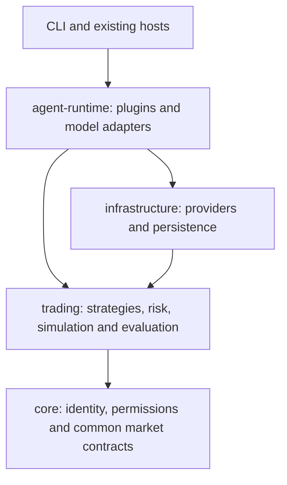
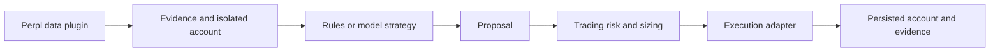

# Trading architecture

This is the current ownership and dependency contract. Historical validation documents describe
past runs; they do not authorize execution or supersede this guide.

## One business implementation

`@pickler/trading/polymarket` owns live execution contracts, paper fills and settlement.
`@pickler/trading/perps` owns virtual perpetual accounts, exact arithmetic, margin, funding and
risk. `@pickler/trading/strategies` owns binary study/benchmark policies and the versioned perpetual strategy registry.
`@pickler/trading/evaluation` owns protocol admission, model ports, perpetual rounds, prospective
BTC scheduling and historical reconciliation. It accepts data, models, repositories, clocks,
cancellation and persistence callbacks. It does not import Node, transport, Mastra or storage.

Core retains identity, agent configuration, plugin permissions, research and public market-data
contracts. It never imports trading. Runtime owns prompts and composes capability adapters.
Infrastructure implements business ports with transactions, leases, HTTP and database access.
API-schema remains portable DTOs, independent from business implementations.

Hosts adapt arguments, environment, files, process signals and report rendering. They freeze
configuration, supply persistence and invoke the shared engine. The local hosts still supply
protocol-specific configuration checks and artifact IO; this is not a deployed web evaluation API.

Binary and perpetual strategies use separate types and accounting. An execution adapter cannot
turn simulated margin into exchange margin rules. Models never control capital, risk limits,
credentials or repositories. Manual operations and evaluations reuse the same business services.
The existing real-trading signer remains confined to its existing host with admissions unchanged.

## Plugins

Each existing ID has a directory under `packages/agent-runtime/src/plugins` and one factory entry.
Core owns the declarative catalog; runtime binds identities to factories without duplicating it.
Research factories expose only injected read capabilities. Execution factories expose operator
services, never model execution tools. Jev and DeepSeek remain model providers, not added IDs.

To add a strategy, define its versioned policy and typed inputs in trading, inject model/data
ports if required, register its evaluation protocol, and replay existing captured inputs. To add
a plugin, update the core catalog, implement its runtime factory and infrastructure adapters,
and test exact registration, permissions and absence of disabled tools. Do not copy risk or
accounting into either a plugin or a host.

## Compatibility and validation

Persisted IDs, versions, prompts, balances, reservations and migrations are unchanged. No schema
migration, automatic restart, paid acceptance, deployment or new live-order authorization is
part of this extraction. Unknown costs retain reservations. Historical STOP files remain intact.

[Evaluation operations](../apps/agent-service/EVALUATIONS.md) documents the sole evaluation CLI.
Run `npm run check:architecture`, root tests (including isolated PostgreSQL), types, lint,
format and shared/service/Worker builds before publishing changes. Controlled replay establishes
compatibility, not provider reliability or profitability.

## Perpetual strategy contract

`PERPS_STRATEGIES` lists `rules`, `deepseek`, `jev` and `combined`, each at policy version
`1.0.0`. `resolvePerpsStrategy({ id, version })` refuses unknown IDs/versions.
`executePerpsStrategy(selection, input, dependencies)` receives evidence and an isolated account,
clones/freezes the snapshot, and returns proposals only. Dependencies supply model capabilities,
a mandatory durable call gate and cancellation. No repository, provider, credential or execution
service is part of the strategy input. Strategy versions identify unchanged decision semantics,
not a new provider/prompt version or a historical data migration.

| Strategy   | Required capabilities   | Existing persisted call lanes |
| ---------- | ----------------------- | ----------------------------- |
| `rules`    | None                    | None                          |
| `deepseek` | `direct`                | `direct`                      |
| `jev`      | `decide`                | `jev`                         |
| `combined` | `direct`, then `review` | `fallback`, then `review`     |

`combined` gets its own account and direct proposal, never the other DeepSeek arm's response.
Historical v1 uses an explicit readiness adapter: `jev`, then conditional `fallback`. It is not
an alias of v2's atomic `jev` or `combined`. Existing evaluation exports remain available for
historical callers, backed by the moved policies, not duplicated implementations.

The evaluator retains joint USD reservations, started-call hashes, usage, unknown-cost handling,
shared execution frames and independent financial accounts. A consumer must implement the call
gate with equivalent admission/ownership and durable accounting before provider transport;
this refactor does not add those guarantees to Studio. It introduces no selector HTTP API,
agent configuration field, migration, live activation or paid evaluation.

To add a strategy, add one versioned descriptor and implementation in trading, declare required
model capabilities, supply runtime adapters, and test exact registry coverage, controlled parity,
isolation, cancellation and call accounting. New execution consumers must use the common risk,
funding, simulator and ledger services. Run `npm run check:architecture`, relevant PostgreSQL
replay tests, types, lint, format and shared/service/Worker builds.
